# Object Detection on the Arduino UNO Q

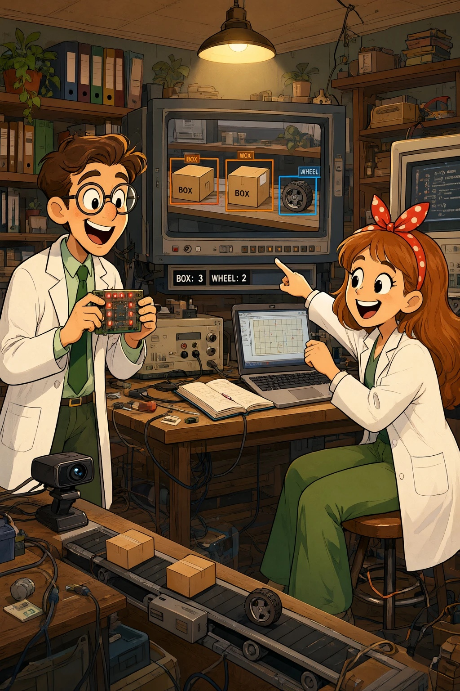

> **Course materials for this chapter** — [slide deck](https://github.com/Mjrovai/UNIFEI-IESTI05-EDGE_AI/blob/main/00_Curso_Folder/4-Generative_AI-UNO-Q/8-Object-Detection/Ch8-Object-Detection.pdf) · [video walkthrough, 18:18](https://youtu.be/m0VSdA2pgBI) (*Chapter 8* of the [IESTI05 lecture series](https://www.youtube.com/playlist?list=PLesj_E3B3AQQ)).

---

## 1. Overview

In the [previous tutorial](../6-Image_Classification/README.md), we trained an image classifier and deployed it to the Arduino UNO Q, first on static images and then on a live camera feed, with the result driving the LED matrix over Bridge. Now we take the next step in computer vision: **Object Detection**.

A classifier answers one question about the whole image: *what is this?* A detector answers two questions for every object it finds: *what is it, and where is it?* That second answer is what makes counting, tracking, sorting, and spatial reasoning possible.

In this tutorial, we will:

- **Part 1**: Run the UNO Q's pre-installed object detection examples. The first is a **static image detector**, where you upload a photo through a web browser and get it back with bounding boxes drawn on it. The second runs the same model on a **live camera feed**.
- **Part 2**: Build a **custom object detector** with Edge Impulse Studio, trained to find **boxes** and **wheels** on a workbench, and deploy it to the UNO Q using **two different approaches**: the App Lab Bricks for static images and for live webcam inference.

As before, we will use the UNO Q's dual-brain architecture: **Python on the MPU** for AI inference and an **Arduino sketch on the MCU** for physical feedback. This time the MCU will not just show a label. It will show a **count** of each object type on the LED matrix, updated as objects enter and leave the camera's view.

### What You Will Learn

- How object detection differs from image classification, and how detectors are evaluated (IoU, mAP)
- How the pre-installed Object Detection and Video Object Detection Bricks work
- How to label a bounding-box dataset and train **FOMO** and **YOLO** models in Edge Impulse Studio
- How to deploy a custom detector via **App Lab Bricks**, on static images and on a live camera feed
- How to turn detections into **counts** and send them to the MCU over Bridge RPC
- Why "nothing detected" needs special handling in a live detection app

---

## 2. Prerequisites

> **Before starting this tutorial, make sure you have:**
>
> - Completed the [Arduino UNO Q Setup Tutorial](../1-Setup/README.md), with the UNO Q reachable via SSH
> - Completed the [Image Classification Tutorial](../6-Image_Classification/README.md). This chapter reuses its Edge Impulse to App Lab workflow and does not repeat every click.
> - An Edge Impulse account (free at [edgeimpulse.com](https://edgeimpulse.com))
> - A USB webcam and a USB hub with power delivery, as in the previous chapter

### Hardware

| Item | Purpose |
|---|---|
| Arduino UNO Q (2 GB or 4 GB) | Edge AI inference + MCU actuation |
| USB webcam | Image capture (Part 1 live demo and Part 2) |
| USB hub with PD | Connect webcam + power to the single USB-C port |
| A few small objects (for example, boxes and toy wheels) | Detection targets for the custom model |

### Software

| Tool | Where |
|---|---|
| Arduino App Lab | Your computer (optional, every step also works from the CLI) |
| Edge Impulse Studio | Browser: [studio.edgeimpulse.com](https://studio.edgeimpulse.com) |
| Roboflow (free account) | Browser: [roboflow.com](https://roboflow.com), only if you label your own images |

> An editor is not required. Every step here works from an SSH terminal. If you'd rather use a full IDE, see [VS Code Remote-SSH setup](../4-Gen_AI_Edge/README.md#2-setting-up-vs-code-with-remote-ssh).

---

## 3. From Image Classification to Object Detection

Object detection builds on image classification but extends it in an important way.

- **Image Classification** assigns a single label to the entire image and answers: "What is the main object or scene in this image?"
- **Object Detection** identifies and locates multiple objects in an image and answers: "Which objects are in this image, and where is each one?" Its output is a list of predictions, each with a **class label**, a **confidence score**, and a **location**.

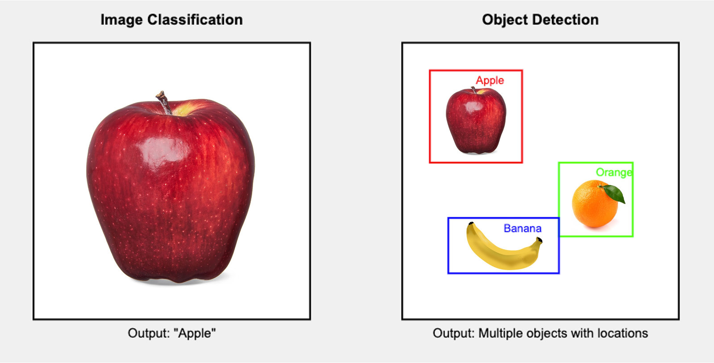

A detector therefore combines two tasks:

1. **Localization**: finding where each object is, usually as a rectangular **bounding box**.
2. **Classification**: deciding what each localized object is, exactly as a classifier would, but per region.

This makes detection harder than classification. An image can contain several objects of different classes, at different sizes, partially hidden behind each other, against a cluttered background, and an edge application usually needs all of that in real time.

### Single-Stage Detectors

Early detectors worked in two stages: first propose regions that might contain an object, then classify each region (R-CNN and its descendants). They are accurate but too slow for an edge device.

Everything we run on the UNO Q is a **single-stage detector**, which predicts locations and classes in one forward pass through the network:

- **YOLO** (You Only Look Once) divides the image into a grid and predicts boxes and classes for every cell at once. It is the family behind the UNO Q's pre-installed model (YOLOX).
- **SSD MobileNet** pairs a MobileNet backbone with a Single Shot Detector head.
- **FOMO** (Faster Objects, More Objects), developed by Edge Impulse, drops the bounding box entirely and predicts only each object's **centroid**. We look at it in more detail in Section 7.

### How Detectors Are Evaluated

Accuracy alone does not describe a detector, because a prediction can have the right class in the wrong place. Three measures matter:

- **Intersection over Union (IoU)** measures how well a predicted box overlaps the ground-truth box drawn by a human: the area of their intersection divided by the area of their union. An IoU of 1.0 is a perfect match. A detection usually counts as correct when IoU ≥ 0.5.

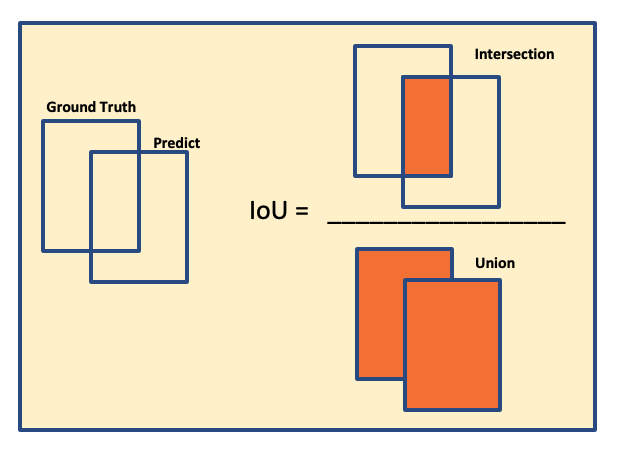

- **Mean Average Precision (mAP)** combines classification and localization into one number. For each class, precision is averaged across recall levels, and the result is averaged across classes. "mAP@0.5" means a detection counts as correct when its IoU is at least 0.5. Edge Impulse reports mAP for YOLO and SSD models.

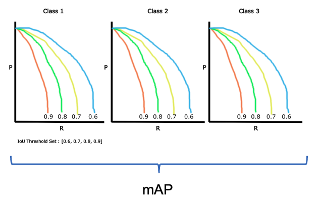

- **Frames Per Second (FPS)**, or its inverse, latency per frame. On the edge, a model that is 3% more accurate but three times slower is often the wrong choice.

### Overlapping Detections and NMS

A detector often reports the same object several times, with slightly different boxes and confidences. **Non-Maximum Suppression (NMS)** cleans this up: keep the most confident box, discard every other box of the same class that overlaps it beyond an IoU threshold, and repeat. On the UNO Q you do not implement NMS yourself. The Edge Impulse model file (`.eim`) already includes it, so the Bricks receive the final, de-duplicated list.

### From Raspberry Pi to UNO Q

If you have worked through the object detection chapters of [EdgeML Made Easy](https://mjrovai.github.io/EdgeML_Made_Ease_ebook/), you have already trained this box-and-wheel detector and run it on a Raspberry Pi. Here is how the UNO Q approach differs:

| Aspect | Raspberry Pi (Zero 2 W / 5) | Arduino UNO Q |
|---|---|---|
| **Camera** | CSI camera or USB webcam | USB webcam (or CSI via the Media Carrier) |
| **Model format** | `.tflite` (LiteRT) or `.eim` | `.eim`, loaded by an App Lab Brick |
| **Inference code** | Your own Python: pre-processing, tensors, NMS, drawing | A Brick call: `detect()` or a callback |
| **Live stream to the browser** | Your own Flask app | Built into the Video Object Detection Brick |
| **Physical output** | GPIO from Python (no real-time guarantees) | Dedicated MCU via Bridge RPC |
| **Deployment** | Run a Python script | Package model + Python + sketch as one App |

On the Pi, we wrote the whole inference pipeline ourselves, which is the best way to understand it. On the UNO Q, the Bricks hide that pipeline, so the work moves to what you **do** with the detections.

> `.tflite` (LiteRT) also worked on the UNO Q, the same way as on the Raspberry Pi. 

---

## 4. Part 1 — Running the Pre-Installed Object Detectors

The UNO Q ships with a general-purpose detector: a **YOLOX-Nano** model trained on the [COCO dataset](https://cocodataset.org), which recognizes 80 everyday classes such as person, cup, cell phone, bottle, chair, cat, and dog. Two examples use it.

| Example | Bricks | Input |
|---|---|---|
| **Detect objects on images** | `object_detection` + `web_ui` | Static image uploaded in the browser |
| **Detect Objects on Camera** | `video_object_detection` + `web_ui` | Live USB webcam |

First, confirm the exact App IDs on your board, since they can change between App Lab releases:

```bash
arduino-app-cli app list --examples | grep -i detect
```

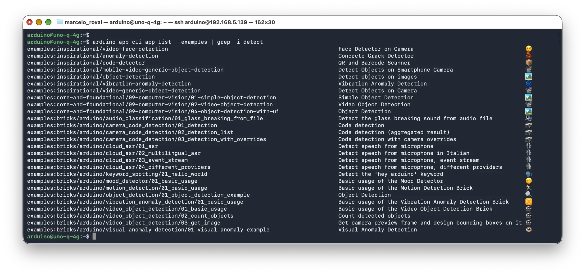

The two we use are `examples:inspirational/object-detection` (**Detect objects on images**) and `examples:inspirational/video-generic-object-detection` (**Detect Objects on Camera**). The list also shows short, single-purpose examples for each Brick, under `examples:bricks/arduino/object_detection/...` and `examples:bricks/arduino/video_object_detection/...`. One of them, `02_count_objects`, counts detections per label, which is the starting point for Section 10.

### Understanding the Architecture

The static image example works exactly like the image classification example from the previous chapter, with one difference: the board sends back an **image** with the boxes drawn on it, not just a list of labels.

```
Browser (your PC)                          UNO Q (MPU / Python)
+-------------------+                     +-------------------------+
|                   |   Upload image      |                         |
|  Web UI (port     | ------------------> |  ObjectDetection Brick  |
|  7000)            |   (base64 via       |  (YOLOX-Nano, COCO)     |
|                   |    WebSocket)       |                         |
|  Shows annotated  | <------------------ |  draw_bounding_boxes()  |
|  image + count    |   PNG with boxes    |  -> base64 PNG          |
+-------------------+                     +-------------------------+
```

### Step 1 — Start the Static Image Example

> **No webcam is needed for this step.**

```bash
arduino-app-cli app start examples:inspirational/object-detection
```

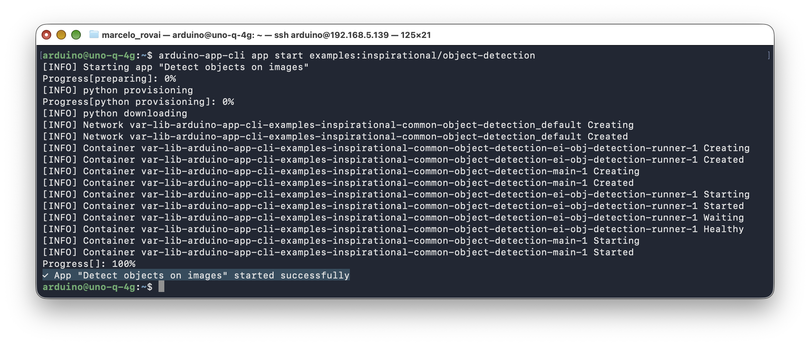

### Step 2 — Open the Web UI and Detect

On your computer, open `http://<UNO_Q_IP_ADDRESS>:7000`. Upload a photo with several everyday objects in it (a desk with a cup, a phone, and a bottle works well), set the **confidence threshold** slider, and click **Run detection**.

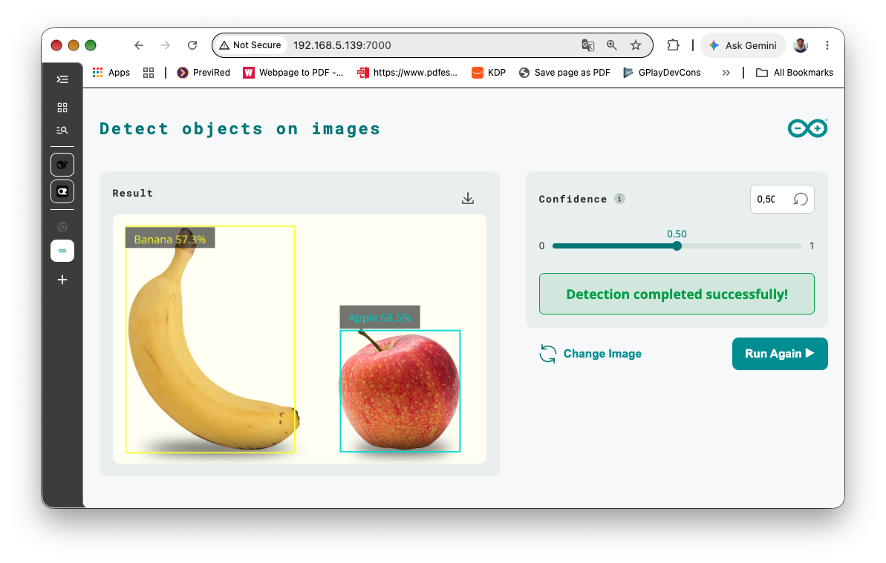

Try the same image at different thresholds. At a high threshold (0.7), you see only the objects the model is sure about. At a low one (0.2), more objects appear, along with false positives. That slider is the single most important tuning knob in any detection application, and we will return to it in Part 2.

> **Note**: As with the classification example, the results go to the browser over WebSocket, not to the terminal log.

### Step 3 — Study the Source Code

```bash
cat /var/lib/arduino-app-cli/examples/inspirational/common/object-detection/python/main.py
```

> **Where the examples live.** The App ID `examples:inspirational/object-detection` maps to the folder `/var/lib/arduino-app-cli/examples/inspirational/common/object-detection`. The `common/` level holds examples that run on every board, and board-specific ones sit next to it, such as `platform_unoq/`. If a path in this chapter does not exist on your board, find it with `sudo find /var/lib/arduino-app-cli/examples -type d -name "object-detection"`.

The core of it, slightly simplified:

```python
from arduino.app_utils import *
from arduino.app_bricks.web_ui import WebUI
from arduino.app_bricks.object_detection import ObjectDetection

object_detection = ObjectDetection()

def on_detect_objects(client_id, data):
    image_bytes = base64.b64decode(data.get('image'))
    pil_image = Image.open(io.BytesIO(image_bytes))
    confidence = data.get('confidence', 0.5)

    results = object_detection.detect(pil_image, confidence=confidence)   # Inference
    img_with_boxes = object_detection.draw_bounding_boxes(pil_image, results)
    # ... encode img_with_boxes as base64 PNG ...
    ui.send_message('detection_result', response)

ui = WebUI()
ui.on_message('detect_objects', on_detect_objects)
App.run()
```

Compared to the classification example:

- `ObjectDetection()` replaces `ImageClassification()`, and `detect()` replaces `classify()`.
- `draw_bounding_boxes()` is new. The Brick draws the boxes and labels for you, so you never handle pixel coordinates unless you want to.
- The structure is otherwise identical: event-driven, no `user_loop`, no Bridge, no MCU.

The result of `detect()` is a dictionary with a single key, `detection`, holding one entry per object found:

```python
{
  "detection": [
    {"class_name": "cup",  "confidence": "87.50", "bounding_box_xyxy": [41.0, 112.0, 98.0, 180.0]},
    {"class_name": "cell phone", "confidence": "64.12", "bounding_box_xyxy": [150.0, 60.0, 210.0, 170.0]}
  ]
}
```

The values above are illustrative, but the format is exact. Two details matter:

- `bounding_box_xyxy` is `[x1, y1, x2, y2]`: the top-left and bottom-right corners, in pixels.
- `confidence` in the **result** is a **string**, formatted as a percentage from 0 to 100 (`"87.50"`). The `confidence` **parameter** you pass to `detect()` is a **float** from 0.0 to 1.0. Mixing the two scales is an easy mistake, so convert with `float(obj["confidence"]) / 100` before comparing.

Stop the example when you are done:

```bash
arduino-app-cli app stop examples:inspirational/object-detection
```

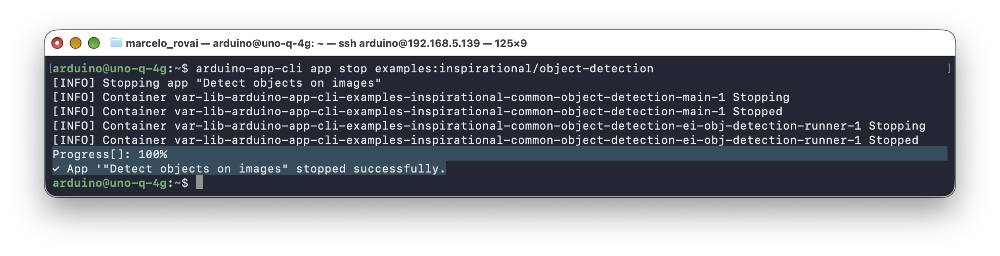

### Step 4 — Run the Live Camera Example

Now connect the webcam through the powered hub and start the second example:

```bash
arduino-app-cli app start examples:inspirational/video-generic-object-detection
```

Open `http://<UNO_Q_IP_ADDRESS>:7000` again. This time you see the **live camera feed with bounding boxes drawn in real time**, each labeled with its class and confidence. On the right are a **Confidence** slider, a **Feedback** panel, and a running list of **Recent detections** with their confidence and timestamp. Point the camera at a cup, a phone, or yourself.

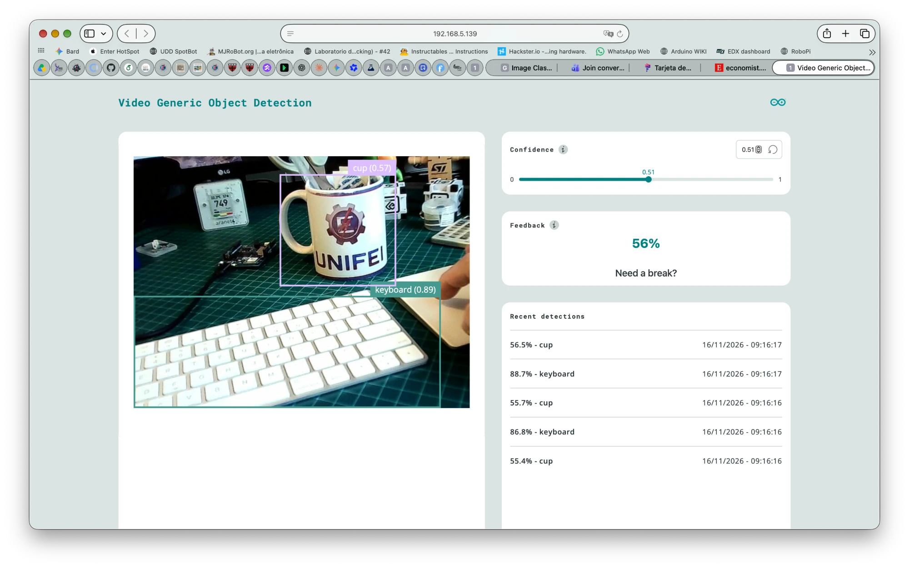

The **Feedback** panel is the example's "special reaction": when one of a handful of COCO classes appears (cat, cell phone, clock, cup, dog, or potted plant), it shows a short message for that object. Here, a cup on the desk triggered "Need a break?". Notice also that the confidence slider is set to 0.51, and the cup is detected at only 0.55–0.57: raise the threshold slightly and the cup disappears while the keyboard (0.87–0.89) stays. That is the threshold tradeoff from Part 1, now happening live.

The architecture has one extra piece:

```
USB Webcam -> VideoObjectDetection Brick -> model runner (YOLOX-Nano)
                                                 |                \
                                     detections (WebSocket)    annotated video
                                                 |              (port 4912, /embed)
                                    on_detect_all(callback)          |
                                                 |                   |
                                   ui.send_message("detection")      |
                                                 \                  /
                                                  Browser (port 7000)
```

The video with boxes is produced by the **model runner** itself and served on port **4912**; the web page simply embeds `http://<UNO_Q_IP>:4912/embed` in an `iframe`. The Python code never touches a frame. It only receives the detections, through callbacks. Look at the source:

```bash
cat /var/lib/arduino-app-cli/examples/inspirational/common/video-generic-object-detection/python/main.py
```

```python
from arduino.app_utils import App
from arduino.app_bricks.web_ui import WebUI
from arduino.app_bricks.video_objectdetection import VideoObjectDetection
from datetime import datetime, UTC

ui = WebUI()
detection_stream = VideoObjectDetection(confidence=0.5, debounce_sec=0.0)

ui.on_message("override_th", lambda sid, threshold: detection_stream.override_threshold(threshold))

def send_detections_to_ui(detections: dict):
  for key, values in detections.items():
    for value in values:
      entry = {
        "content": key,
        "confidence": value.get("confidence"),
        "timestamp": datetime.now(UTC).isoformat()
      }
      ui.send_message("detection", message=entry)

detection_stream.on_detect_all(send_detections_to_ui)

App.run()
```

Notice the shape of `detections`. It is **grouped by label**, with a list of every instance of that label in the frame:

```python
{
  "cup":    [{"confidence": 0.91, "bounding_box_xyxy": (41, 112, 98, 180)}],
  "person": [{"confidence": 0.88, "bounding_box_xyxy": (...)},
             {"confidence": 0.62, "bounding_box_xyxy": (...)}]
}
```

That grouping makes counting trivial: `len(detections["person"])` is the number of people in the frame. Note also that here `confidence` is a **float from 0 to 1**, unlike the static Brick's percentage string.

The slider calls `override_threshold()`, which changes the threshold inside the running model without restarting the app.

Stop the example:

```bash
arduino-app-cli app stop examples:inspirational/video-generic-object-detection
```

### Running the Examples from Arduino App Lab

As with image classification, both examples are also available in the App Lab on your computer: connect to the UNO Q over Wi-Fi, open **Inspirations**, and choose **Detect objects on images** or **Detect Objects on Camera**. The camera example must run in **Network Mode**, because the webcam occupies the hub. While an app runs, its card shows **Running**, and the bottom bar shows its name with a **Stop** button.

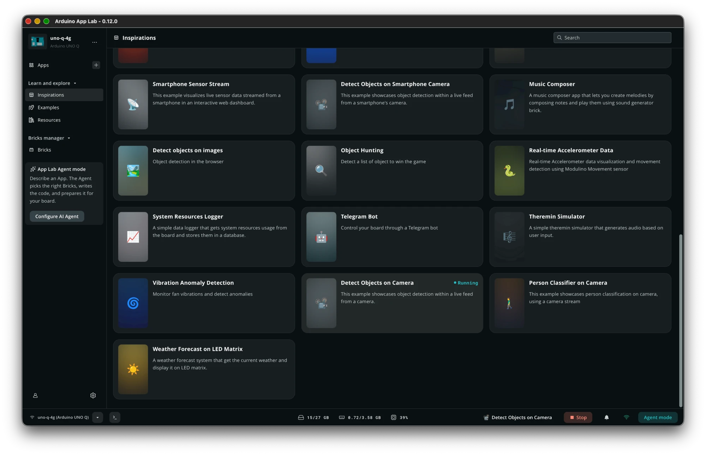

Two more Inspirations use the same detector and are worth a look:

- **Detect Objects on Smartphone Camera** runs the same live detection on your phone's camera instead of a USB webcam. If you don't have a webcam or a powered hub yet, this is a way to try live detection right now.
- **Object Hunting** turns detection into a game: the app gives you a list of objects to find and show to the camera.

### What We Learned from Part 1

The pre-installed detector is impressive, but it has the same limitations the classification example had:

- It knows only COCO's 80 classes. It has never seen *your* objects.
- Results stay in the browser. Nothing physical happens.
- YOLOX-Nano is sized for general use, not for the speed your application might need.

In Part 2, we train a model on our own objects, deploy it with the same two Bricks, and connect it to the MCU.

---

## 5. Part 2 — Building a Custom Object Detector

We will reuse the project from the [EdgeML Made Easy](https://mjrovai.github.io/EdgeML_Made_Ease_ebook/raspi/object_detection/custom_object_detection.html) object detection chapter, so readers who did it on a Raspberry Pi can compare the two boards directly.

### Project Goal

Assume we are in an industrial facility and must **sort and count wheels and special boxes** passing in front of a camera.

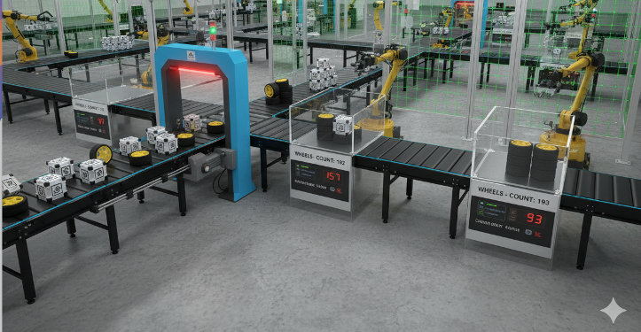

Each image may contain any number of boxes and wheels, or none at all:

- **box**
- **wheel**
- (background, meaning no objects, is handled implicitly)

The system should **continuously** capture frames, detect every object, count them by class, and show the counts on the UNO Q's LED matrix:

```
USB Webcam -> VideoObjectDetection Brick -> custom EI model -> {"Box": [...], "Wheel": [...]}
                                                                       |
                                                        count per class (Python)
                                                                       |
                                                Bridge.call("show_counts", boxes, wheels)
                                                                       |
                                                           MCU (Arduino sketch)
                                                           -> LED matrix: boxes | wheels
```

As in the previous chapter, we show **two deployment paths**:

- **Path A (Section 8)**: Deploy via the **Object Detection Brick**, reusing the static image example with our custom model. Quick to set up and ideal for checking the model.
- **Path B (Section 9)**: Deploy via the **Video Object Detection Brick**, for live camera inference. Section 10 then adds counting and MCU actuation. **Recommended for real projects.**

---

## 6. Data Collection and Labeling

An object detection dataset needs more than images in labeled folders: every object in every image needs a **bounding box** and a label. That makes labeling the most time-consuming part of the project.

### Option A: Use the Ready-Made Dataset (Recommended for a First Run)

The labeled, pre-processed dataset from the Raspberry Pi project is public on Roboflow Universe: [box-versus-wheel-auto-dataset](https://universe.roboflow.com/marcelo-rovai-riila/box-versus-wheel-auto-dataset). It has **153 images at 320×320**, already split into train, validation, and test sets, with augmentation applied.

Download it in **YOLOv8** format (a zip file). Inside, each split has an `images` folder and a `labels` folder; every `image_id.jpg` has a matching `image_id.txt` with one line per object: `class_id x_center y_center width height`, normalized to the image size. `data.yaml` maps the class IDs to names: `0` is `box` and `1` is `wheel` (alphabetical order).

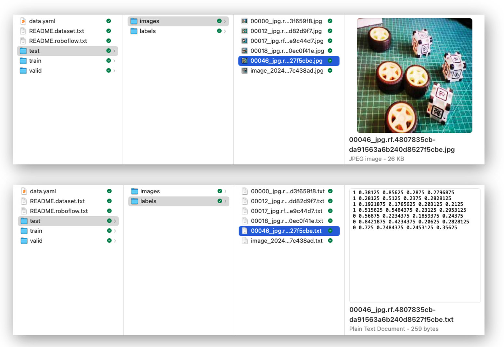

### Option B: Capture and Label Your Own Images

A model trained on your own boxes, under your own lighting, will perform better on your bench. To capture on the UNO Q, reuse the `capture_images.py` script from the [Image Classification chapter](../6-Image_Classification/README.md#option-b-capturing-images-on-the-uno-q), with two changes: set `label = "box-wheel"` (the real labels are added later, per object), and capture at **320×320** or crop to square afterward.

> Capture about 60 images. Vary the angles, backgrounds, distances, and lighting, and vary **how many** objects appear in each frame, from zero to several of each kind. Include some frames with **no objects at all**.

Copy the images to your computer (`scp -r arduino@<UNO_Q_IP>:~/dataset ./dataset`) and label them. You can label directly in Edge Impulse Studio (**Data acquisition > Labeling queue**), or use [Roboflow](https://roboflow.com) as we did for the Pi, which offers auto-labeling and exports to several formats:

1. Create a project (for example, "box-versus-wheel") and upload the raw images.
2. Draw a box around every object, or use **Auto Label** / **Label Assist** and correct its suggestions.

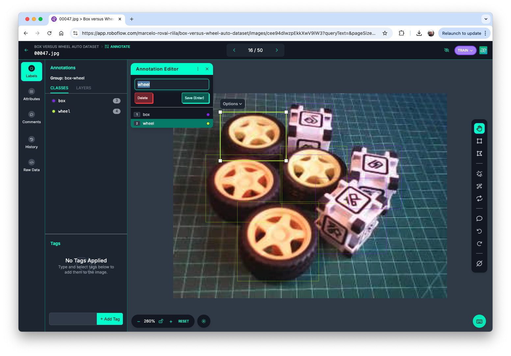

3. Mark background-only images with the **Null** tool, so they are kept with no annotations.

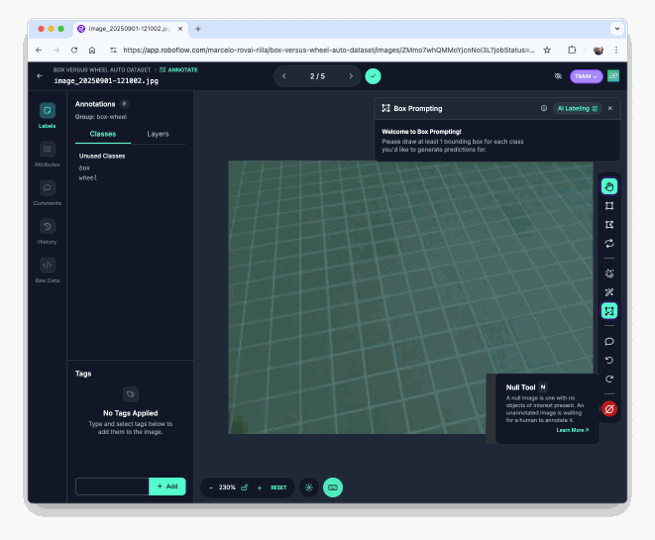

4. Split into train, validation, and test, resize to **320×320** (stretch), and add augmentation (for example, ±15° rotation, crop, brightness, and exposure).

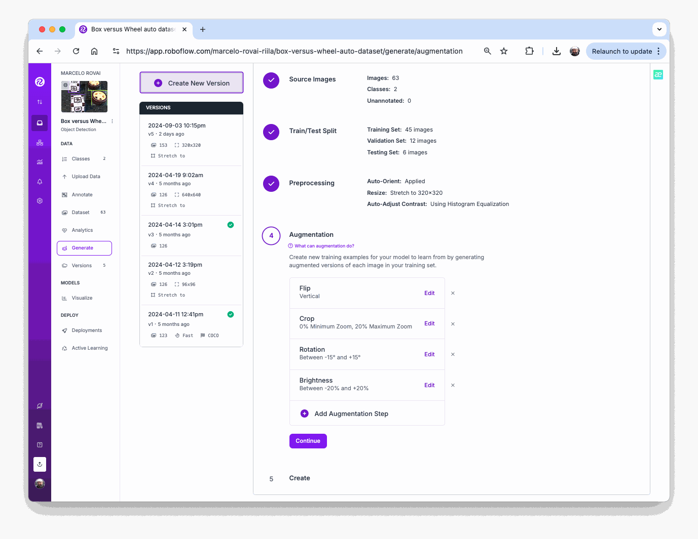

5. Export in **YOLOv8** format.

> **Why not label in Edge Impulse directly?** You can, and for a small dataset it is the shortest path. A dataset labeled on a free Edge Impulse account cannot be exported for training elsewhere, though, while a Roboflow export can also be used to train a YOLO model with Ultralytics, as in the Pi book.

### Upload to Edge Impulse Studio

1. In Edge Impulse Studio, create a new project (for example, "UNO-Q - Custom Object Detection").
2. On the **Dashboard**, under **Project info**, set the **Labeling method** to **Bounding boxes (object detection)**.
3. Go to **Data acquisition > Upload data**. Choose **Select a folder**, pick the `train` folder (with its `images` and `labels` subfolders), set the label format to **YOLO TXT**, choose the **Training** category, and upload.
4. Repeat for the `test` and `valid` folders, into the **Test** category.

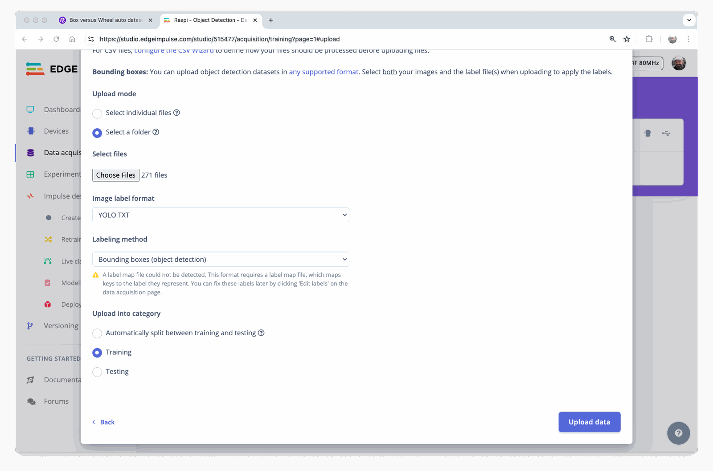

> **Check the label names.** After uploading, open a few samples. If the objects are labeled `0` and `1` instead of `box` and `wheel`, the class names did not come across. Rename them now (in **Data acquisition**, filter by label and use **Edit labels**), because these strings are exactly what your Python callbacks will match against later.

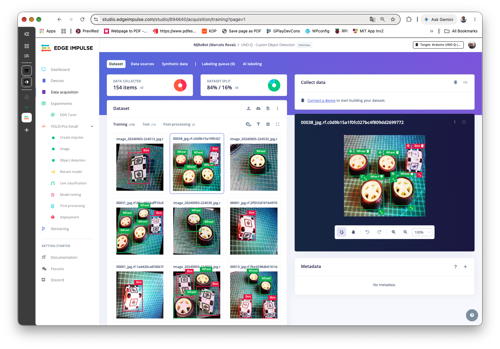

> **Shortcut:** the project used in this chapter is public: [UNO Q - Custom Object Detection](https://studio.edgeimpulse.com/public/894640/live). Click **Clone** to copy it into your account, dataset and impulses included, and compare your results with ours.

---

## 7. Training the Models with Edge Impulse Studio

We will train **two** models on the same dataset and compare them on the board: **FOMO**, the fastest option, and **YOLO**, the most precise. Edge Impulse's **Experiments** feature lets one project hold both impulses side by side.

### How FOMO Works

FOMO (Faster Objects, More Objects) uses a **MobileNetV2** backbone to extract a feature map, then classifies each cell of a coarse grid instead of regressing box coordinates. The image is divided by a factor of 8, so a 160×160 input becomes a 20×20 grid, and each cell answers "is the center of a box, or of a wheel, here?"

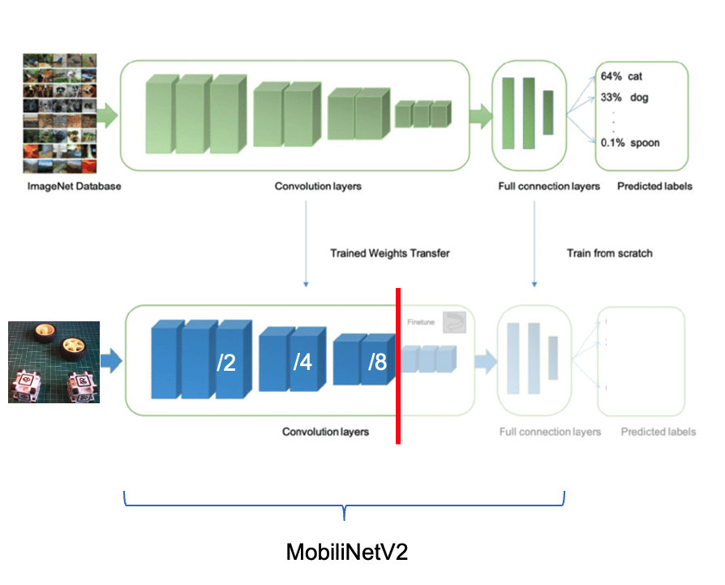

Neighboring cells that fire for the same class are merged into one object, located at their **centroid**.

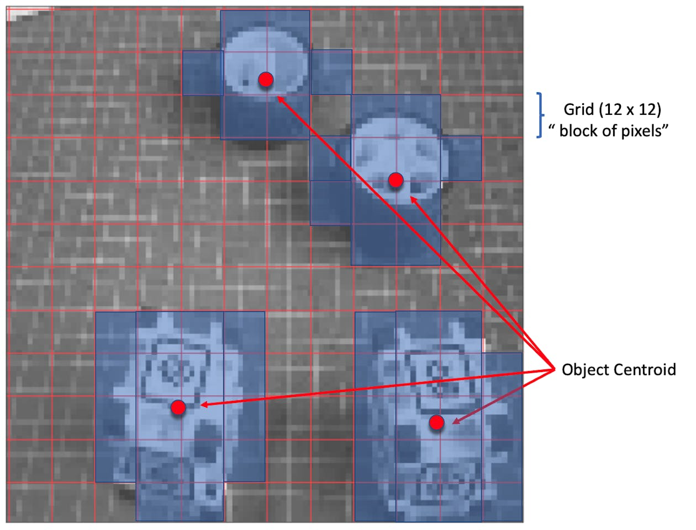

The tradeoff is clear:

- **What you gain**: speed and memory. the FOMO model itself is much smaller and faster than SSD or YOLO, and it handles many small, well-separated objects well. (In an application, the end-to-end gap is smaller than the models alone suggest, as we will measure in Section 8.)
- **What you lose**: object size. FOMO reports where an object is, not how big it is. The "box" it returns is a cell-sized square around the centroid, not a fitted rectangle. The Brick's `draw_bounding_boxes()` knows this: for a FOMO model, it draws **circles** instead of rectangles.

For counting boxes and wheels, size does not matter, so FOMO is a very good fit. For anything that needs an object's extent (distance estimation, cropping an object for a second model, overlap checks), you need YOLO.

### Impulse 1 — FOMO

1. Go to **Create impulse**. When asked for a target device, choose **Arduino UNO Q** (this only affects the latency estimates, not the training).
2. Set the input to **160×160**, resize mode **Squash**.
3. Add an **Image** processing block and an **Object Detection (Images)** learning block.
4. **Save Impulse**.
5. In the **Image** tab, set **Color depth** to **RGB**, **Save parameters**, and **Generate features**.
6. In the **Object detection** tab, choose **FOMO (Faster Objects, More Objects) MobileNetV2 0.35**.
7. Train with **60 epochs**, learning rate **0.001**, and **no data augmentation** if you used the Roboflow dataset, which is already augmented.

Edge Impulse reports an **F1 score** for FOMO rather than mAP, because there are no boxes to compute IoU against, only centroids.

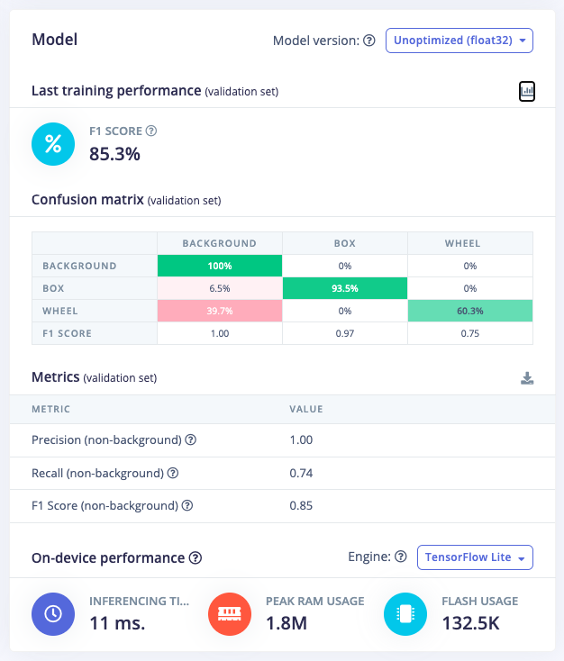

> For FOMO, we will use the **float32** version. The model is small in memory and fast, and in our training the quantized (int8) version's F1 score dropped below 0.70.

### Impulse 2 — YOLO

1. Go to **Experiments** and create a new impulse.
2. Set the input to **320×320** (the resolution of the Roboflow dataset).
3. Add **Image** and **Object Detection (Images)** blocks and generate RGB features as before.
4. In the **Object detection** tab, choose a **YOLO** architecture. At the time of writing, Edge Impulse offers its own **YOLO-Pro** family. Pick the small variant first (6.9M).
5. Train (start with **30 epochs**; YOLO benefits from more if you have the time).

Edge Impulse reports **mAP@0.5** (and mAP@[0.5:0.95]) for this model.

> For YOLO-Pro Small, we will deploy the **quantized (int8)** version. Check its mAP in the **Model version** selector before deploying: if it is close to the float32 value, int8 is the better choice, because it is smaller and usually faster on the UNO Q's CPU.

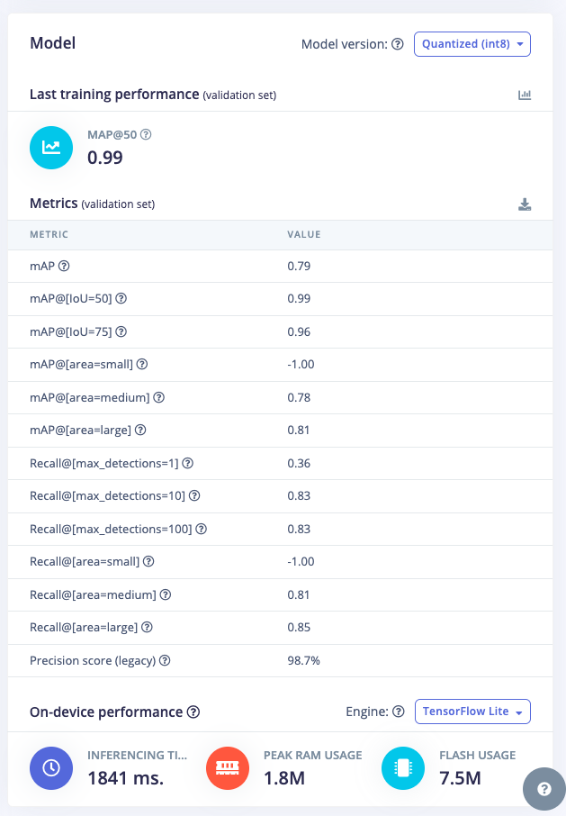

### Test Both Models

Go to **Model testing**, select the version you will deploy (float32 for FOMO, int8 for YOLO), and click **Classify all** for each impulse. Look at the test images where the models disagree: FOMO typically misses objects that touch each other (their centroids fall in the same cell), while YOLO is more likely to miss very small objects at 320×320 than you might expect.

Record the results; we will compare them with on-board measurements in Section 11.

| Model | Input | Metric (test set) | Estimated latency (EI) |
|---|---|---|---|
| FOMO MobileNetV2 0.35 | 160×160 | F1 = **0.82** | **11** ms |
| YOLO-Pro Small (6.9M) | 320×320 | mAP@0.5 = **0.99** | **1,841** ms |

> **F1 and mAP are not directly comparable.** FOMO's F1 counts a detection as correct when its centroid lands on the right object; YOLO's mAP@0.5 also requires the predicted box to overlap the labeled box by at least 50%. So 0.82 against 0.99 does not mean YOLO is "20% better". Compare the models on what your application needs, here whether the counts are right, and on latency.

> **A smaller YOLO is also an option.** We picked YOLO-Pro Small (6.9M parameters). The smallest variant, YOLO-Pro Pico (682K parameters), would have a much lower latency, probably at the cost of some mAP. If you need boxes rather than centroids but YOLO-Pro Small turns out too slow for your application, train a smaller variant as a third experiment and compare. We tried YOLO-Pro Nano (2.4M parameters, int8): it kept mAP@0.5 at 0.99 on the validation set, counted all six test images correctly, and ran more than twice as fast as Small on the live stream (Section 8, Step 7, and Section 11). (As Section 8 shows, measure on the board before deciding: the estimate above turned out far too pessimistic.)

---

## 8. Deploying to the UNO Q — Path A: Object Detection Brick

This path puts your custom model into the static image example from Part 1. It is limited to uploads, but it is the fastest way to see your model running on the board and to inspect what it returns.

### Step 1 — Copy the Pre-Installed Example

```bash
cp -r /var/lib/arduino-app-cli/examples/inspirational/common/object-detection/ ~/ArduinoApps/my-detector-bricks
```

The copy appears in App Lab's **Apps** list, but still as **Detect objects on images**: App Lab shows the `name:` field from `app.yaml`, not the folder name, and `cp` copied the example's `app.yaml` unchanged. Give it its own name:

```bash
sed -i 's/^name: .*/name: My Detector (Custom Images)/' ~/ArduinoApps/my-detector-bricks/app.yaml
```

Or, in Arduino App Lab, copy **Detect objects on images** to **My Apps** under a new name, which sets the name for you.

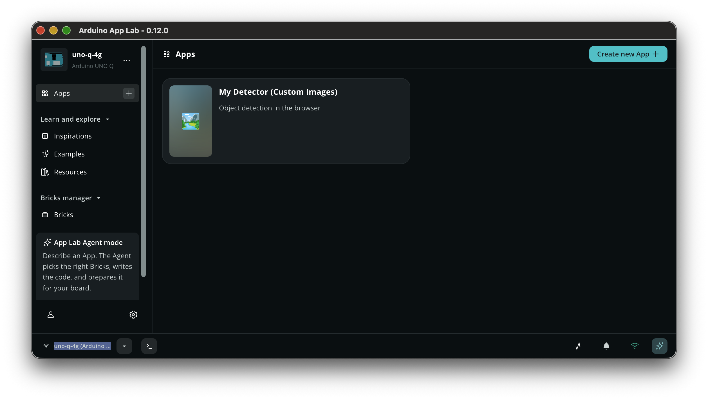

### Step 2 — Export the Model from Edge Impulse to the Arduino App Lab

This is the same flow as in the [Image Classification chapter](../6-Image_Classification/README.md#step-2--export-the-model-from-edge-impulse-to-the-arduino-app-lab):

1. In the copied app, open **Bricks > Object Detection > AI models** and click **Train new AI model**.
2. Log in to your Arduino / Edge Impulse account and open your object detection project.
3. Make sure the impulse you want to deploy (start with **FOMO**) is the active one.
4. In **Deployment**, select **Arduino UNO Q** as the target. Under model optimizations, choose the same version you tested in Section 7 (**float32**, unoptimized), and **Build**.
5. When the build finishes, click **Go to Arduino** to send the model to App Lab.

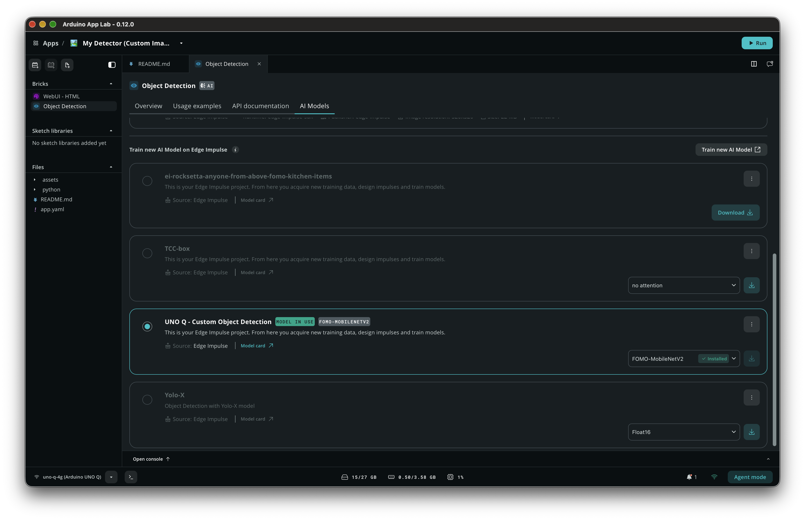

### Step 3 — Select the Model on the UNO Q

In the app's **AI Models** area, download the model to the UNO Q and select it. `app.yaml` is updated to point to it:

```yaml
name: My Detector (Custom Images)
icon: 🏞️
description: Custom object detection in the browser
bricks:
- arduino:web_ui: {}
- arduino:object_detection:
    model: ei-model-<PROJECT_ID>-1
```

App Lab stores the model in its own folder, `/home/arduino/.arduino-bricks/models/custom-ei/ei-model-<PROJECT_ID>-<VERSION>/`.

### Alternative to Steps 2 and 3 — Load the `.eim` File Directly

The App Lab flow above works, but it takes several hops between Edge Impulse, App Lab, and the board. There is a shorter path: download the model file yourself and point the Brick at it.

It works because of how the Brick runs the model. The Object Detection Brick starts the Edge Impulse runner in a container with `--model-file ${EI_OBJ_DETECTION_MODEL}`, and that container can see the folder `/home/arduino/.arduino-bricks/ei-models`. Any variable you set in a Brick's `variables:` block in `app.yaml` is passed to the container and takes priority over the default model.

1. In Edge Impulse **Deployment**, select **Arduino UNO Q** (or **Linux (AARCH64)**), choose **float32**, and **Build**. The browser downloads a file such as `uno-q-custom-object-detection-linux-aarch64-v12-fomo-mobilenetv2.eim`.

2. Copy it to the board (from your computer):

```bash
scp ~/Downloads/uno-q-custom-object-detection-linux-aarch64-v12-fomo-mobilenetv2.eim arduino@<UNO_Q_IP>:~/
```

3. On the UNO Q, move it into the models folder under a short name, and make it executable (an `.eim` file is a program, and the runner needs to execute it):

```bash
mkdir -p ~/.arduino-bricks/ei-models
mv ~/uno-q-custom-object-detection-linux-aarch64-v12-fomo-mobilenetv2.eim ~/.arduino-bricks/ei-models/box-wheel-fomo.eim
chmod +x ~/.arduino-bricks/ei-models/box-wheel-fomo.eim
```

4. Edit `app.yaml`: **remove the `model:` line** and set the variable instead. Removing `model:` is not optional. When it is present, the CLI applies that model's configuration, which mounts only the App Lab model's own folder into the container, so the runner cannot see `ei-models/` and fails with `ENOENT: no such file or directory`. Selecting a model in App Lab writes the line back, so check `app.yaml` again if you go back to App Lab.

   Any terminal editor works. With `nano app.yaml`, place the cursor on a line and press **Ctrl+K** to delete it, then type the new lines and save with **Ctrl+O**, **Enter**, **Ctrl+X**. The result:

```yaml
name: My Detector (Custom Images)
icon: 🏞️
description: Custom object detection in the browser
bricks:
- arduino:web_ui: {}
- arduino:object_detection:
    variables:
      EI_OBJ_DETECTION_MODEL: /home/arduino/.arduino-bricks/ei-models/box-wheel-fomo.eim
```

5. Start the app:

```bash
cd ~/ArduinoApps/my-detector-bricks
arduino-app-cli app start .
```

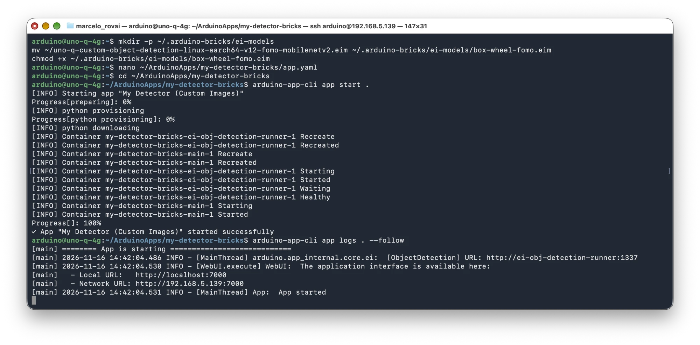

Upload an image in the browser: if the labels are **Box** and **Wheel**, the Brick is running your model. If you see COCO classes such as *cup* or *person*, the variable did not take effect; check the path and the `chmod`. If the app fails to start with `container ... ei-obj-detection-runner-1 is unhealthy`, read the runner's own log, which shows the actual error:

```bash
docker logs --tail 20 my-detector-bricks-ei-obj-detection-runner-1
```

This option has a second advantage: switching models becomes a one-line change. Copy the YOLO `.eim` next to the FOMO one, and you can compare the two by editing `app.yaml` and restarting the app.

### Step 4 — Print Model Info, Detections, and Latency

Before running, replace `python/main.py` with a version that also prints what the model expects and what it finds. The model info is worth reading once: it tells you the **exact label strings** your callbacks must use, the input size, and the model type (`object_detection` for YOLO, `constrained_object_detection` for FOMO).

```python
from arduino.app_utils import App
from arduino.app_bricks.web_ui import WebUI
from arduino.app_bricks.object_detection import ObjectDetection
from PIL import Image
import io
import base64
import time

object_detection = ObjectDetection()


def print_model_info(detector):
    info = detector.get_model_info()
    if info is None:
        print("Failed to retrieve model info.")
        return
    print("Model info:")
    for attr in dir(info):
        if not attr.startswith("_") and not callable(getattr(info, attr)):
            print(f"  {attr}: {getattr(info, attr)}")


def encode_png(pil_image):
    buf = io.BytesIO()
    pil_image.save(buf, format="PNG")
    return base64.b64encode(buf.getvalue()).decode("utf-8")


def on_detect_objects(client_id, data):
    try:
        image_data = data.get("image")
        confidence = data.get("confidence", 0.5)
        if not image_data:
            ui.send_message("detection_error", {"error": "No image data"})
            return

        pil_image = Image.open(io.BytesIO(base64.b64decode(image_data)))

        start = time.perf_counter()
        results = object_detection.detect(pil_image, confidence=confidence)
        latency_ms = (time.perf_counter() - start) * 1000

        if results is None:
            ui.send_message("detection_error", {"error": "No results returned"})
            return

        detections = results.get("detection", [])
        counts = {}
        for obj in detections:
            counts[obj["class_name"]] = counts.get(obj["class_name"], 0) + 1
            print(f"  {obj['class_name']:6s} {float(obj['confidence']):5.1f}%  "
                  f"box={[round(v) for v in obj['bounding_box_xyxy']]}")
        print(f"Counts: {counts}  |  Latency: {latency_ms:.1f} ms\n", flush=True)

        annotated = object_detection.draw_bounding_boxes(pil_image, results)
        ui.send_message("detection_result", {
            "success": True,
            "result_image": encode_png(annotated if annotated is not None else pil_image),
            "detection_count": len(detections),
            "processing_time": f"{latency_ms:.2f} ms",
        })

    except Exception as e:
        ui.send_message("detection_error", {"error": str(e)})


print_model_info(object_detection)
ui = WebUI()
ui.on_message("detect_objects", on_detect_objects)

App.run()
```

### Step 5 — Run the App

```bash
cd ~/ArduinoApps/my-detector-bricks
arduino-app-cli app start .
```

In a second terminal, follow the logs:

```bash
cd ~/ArduinoApps/my-detector-bricks
arduino-app-cli app logs . --follow
```

Open `http://<UNO_Q_IP>:7000` and upload test images of boxes and wheels (the `test` folder of the dataset is a good source). For the FOMO model, the browser shows **circles** at each object's centroid. The log shows each detection, the counts, and the latency.

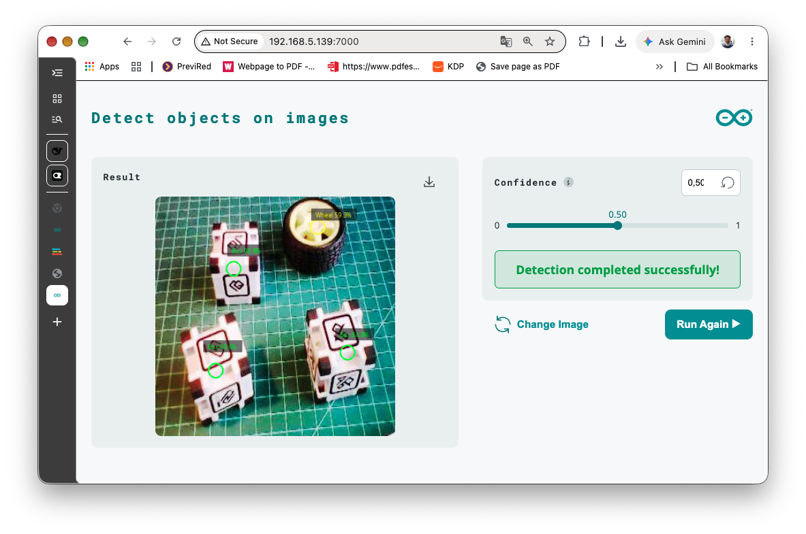

Here the FOMO model got everything right: three boxes and one wheel, each marked by a circle at its centroid. Note the labels, **Box** and **Wheel**, with capital letters: these are the exact strings your code must match in Section 10.

Upload more test images, though, and FOMO's limits show up quickly. Two failures are typical:

- **Missed objects.** In the image below, the model found three of the four wheels and one of the three boxes. The misses are objects cut by the image edge, partly hidden behind others, or seen from an unusual angle.

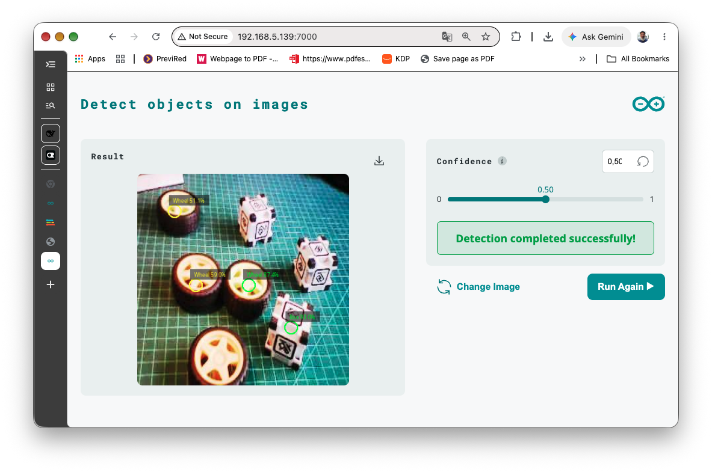

- **One object, several centroids.** When an object is large in the frame, it covers many cells of FOMO's grid, and separate groups of cells can each report a centroid. The single box below was counted three times.

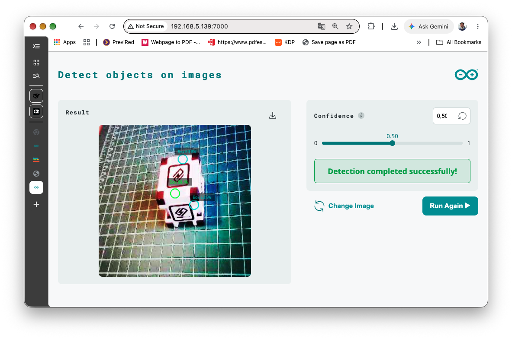

Both explain why the F1 score in Section 7 was 0.82, and both matter for counting: a miss lowers the count, a split raises it. Keep the objects at roughly the distance and size they had in the training images, and if they must appear large in the frame, prefer YOLO, which fits one box to each object.

The log for six test images, starting with the one above:

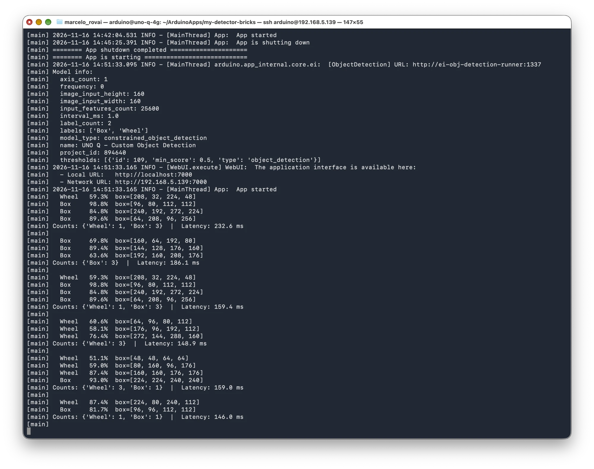

Three things are worth reading in it:

- **The model info** confirms what we trained: a 160×160 input, two labels, `['Box', 'Wheel']`, and `model_type: constrained_object_detection`, which is how Edge Impulse identifies a FOMO model (a YOLO model reports `object_detection`).
- **The boxes are small, fixed-size squares** (16 or 32 pixels wide), centered on each object, because FOMO reports centroids, not object sizes. Their coordinates also go up to 288, beyond the model's 160×160 input: the Brick returns them **in the uploaded image's pixel space**, so you can use them directly on the original image.
- **The first inference is the slowest.** The first and third images are the same file, with identical detections, yet they took 232.6 ms and 159.4 ms. The first call after the app starts pays a one-time warm-up cost. Ignoring it, the other five took between 146 and 186 ms, about **160 ms** on average, against an estimate of about 11 ms in Edge Impulse.

> **Latency here includes more than the model.** The time measured around `detect()` also covers encoding the image, sending it to the model runner container over HTTP, resizing it to 160×160, and returning the result. The model itself is a small fraction of the 160 ms. When you measure, always discard the first call and average several. That end-to-end number is the one your application will actually see, and it is why Edge Impulse's estimate alone is not enough to choose a model.

### Step 6 — Repeat with YOLO

Now deploy the **YOLO-Pro Small** impulse the same way, this time choosing **Quantized (int8)** under model optimizations. With the direct `.eim` option, this is a one-line change in `app.yaml` (point `EI_OBJ_DETECTION_MODEL` to `box-wheel-yolo.eim`) and an app restart. Copy and rename the file as we did for FOMO:

```bash
mv ~/uno-q-custom-object-detection-linux-aarch64-v15-yolo-pro-small.eim ~/.arduino-bricks/ei-models/box-wheel-yolo.eim
chmod +x ~/.arduino-bricks/ei-models/box-wheel-yolo.eim
```

Upload the same test images.

The browser now shows fitted **rectangles**, and the two scenes where FOMO failed come out right. The single large box is counted once:

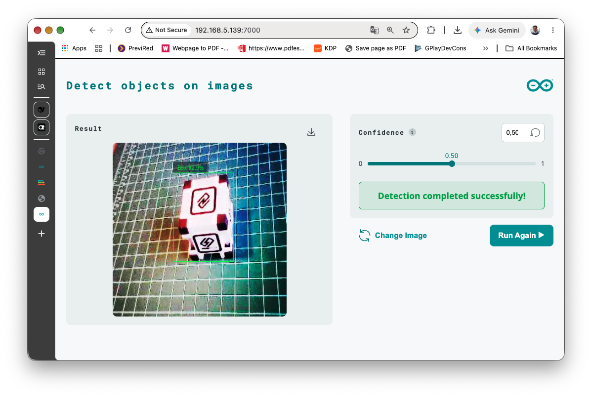

And the crowded scene, where FOMO found three wheels and one box, is now complete, with four wheels and three boxes:

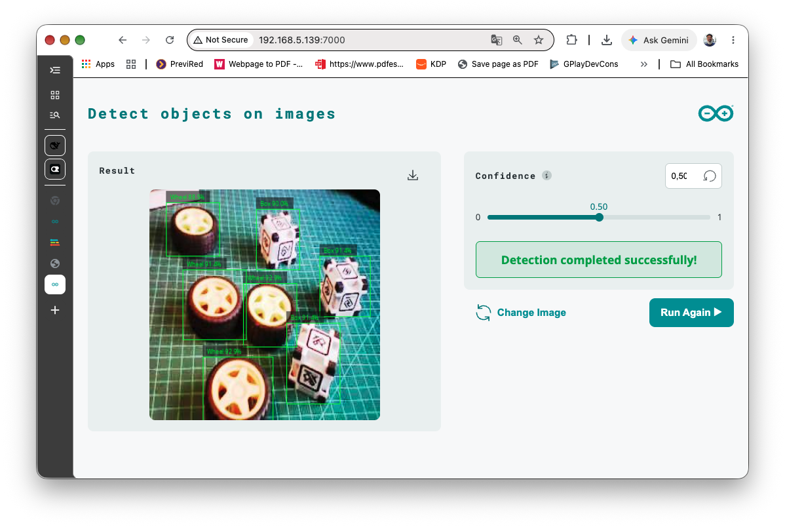

YOLO counted all six test images correctly, against two for FOMO. The log shows why it costs more:

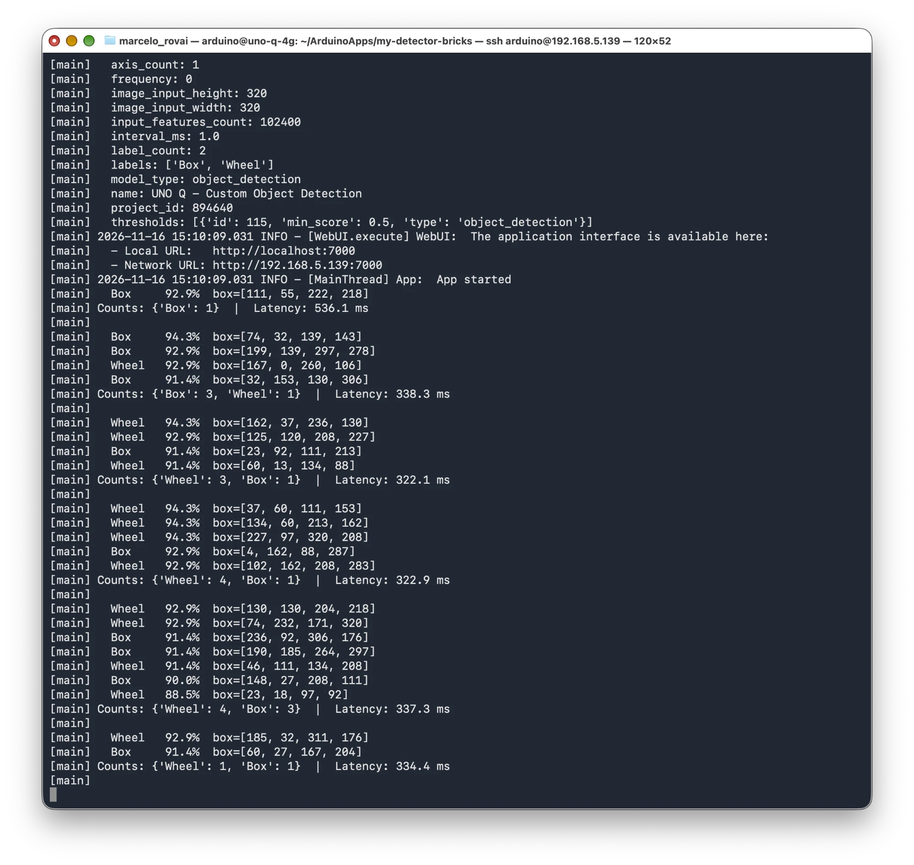

- **The model info** reports a 320×320 input and `model_type: object_detection`, the YOLO family. The labels are the same, so the Python code does not change.
- **The boxes now have real sizes**, fitted to each object.
- **The latency is about 331 ms** on average after the warm-up call (536 ms), twice FOMO's 160 ms.

That last number deserves a second look. Edge Impulse estimated **1,841 ms** for this model, more than five times what the board actually measured. For FOMO, the estimate was 11 ms against 160 ms measured. The estimates were wrong in both directions: one ignores the fixed cost of moving the image to the runner, and the other did not anticipate how fast the runner executes this model on the UNO Q. **Always measure on the board before choosing a model.**

### Step 7 — Try a Smaller YOLO

If YOLO-Pro Small counts well but you want more speed, train a smaller variant and compare it on the board. We trained **YOLO-Pro Nano** (2.4M parameters), deployed it as **Quantized (int8)**, and installed it next to the others:

```bash
mv ~/uno-q-custom-object-detection-linux-aarch64-v16-yolo-pro-nano.eim ~/.arduino-bricks/ei-models/box-wheel-yolo-nano.eim
chmod +x ~/.arduino-bricks/ei-models/box-wheel-yolo-nano.eim
```

Then we pointed `EI_OBJ_DETECTION_MODEL` to `box-wheel-yolo-nano.eim` and restarted the app. It also counted all six test images correctly, including the crowded scene:

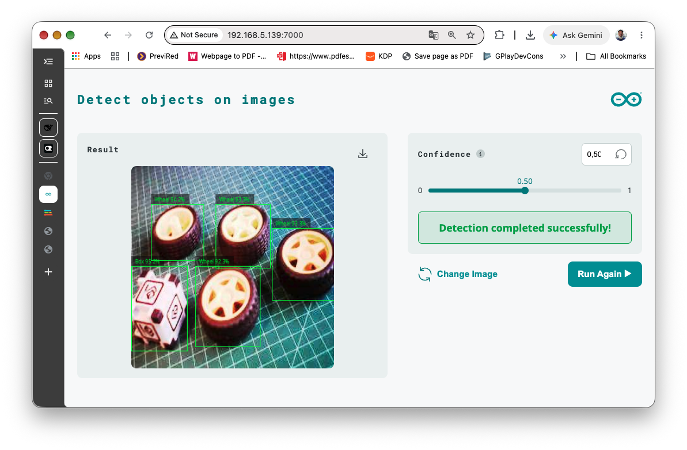

On the board, it took about 221 ms per image (342 ms for Small). Section 11 compares all the models side by side.

---

## 9. Deploying to the UNO Q — Path B: Live Camera

Now we move to the live camera. Rather than building a web page from scratch, we start from the **Detect Objects on Camera** example, which already streams the annotated video to the browser, and swap in our model.

### Step 1 — Copy the Live Camera Example

```bash
cp -r /var/lib/arduino-app-cli/examples/inspirational/common/video-generic-object-detection/ ~/ArduinoApps/box-wheel-counter
sed -i 's/^name: .*/name: Box Wheel Counter/' ~/ArduinoApps/box-wheel-counter/app.yaml
```

As in Path A, the `sed` line renames the app in App Lab's list. Or copy **Detect Objects on Camera** to **My Apps** in App Lab, naming it `Box Wheel Counter`.

### Step 2 — Select Your Model

From here on, we use **YOLO-Pro Nano**, which counted every test image correctly in Section 8 and is the fastest of our YOLO models. (YOLO-Pro Small and FOMO work too, with the same code; only the model file changes.)

Open **Bricks > Video Object Detection > AI Models** and select the YOLO-Pro Nano model you deployed in Section 8 (the same `.eim` works with both Bricks). `app.yaml` becomes:

```yaml
name: Box Wheel Counter
icon: 📽️
description: Count boxes and wheels on a live camera feed
bricks:
- arduino:video_object_detection:
    model: ei-model-<PROJECT_ID>-1
- arduino:web_ui: {}
```

If you loaded the `.eim` file directly in Section 8, do the same here. The video Brick uses a different variable name, `EI_V_OBJ_DETECTION_MODEL`. As in Section 8, there is no `model:` line. The complete `app.yaml` is:

```yaml
name: Box Wheel Counter
icon: 📽️
description: Count boxes and wheels on a live camera feed
bricks:
- arduino:video_object_detection:
    variables:
      EI_V_OBJ_DETECTION_MODEL: /home/arduino/.arduino-bricks/ei-models/box-wheel-yolo-nano.eim
- arduino:web_ui: {}
```

Edit it with `nano app.yaml`, as in Section 8 (**Ctrl+K** deletes the `model:` line).

### Step 3 — Run It Unchanged

The example's `main.py` is generic: it forwards every detection to the browser, whatever the labels are. So the app already works with our model, without changing a line of Python.

```bash
cd ~/ArduinoApps/box-wheel-counter
arduino-app-cli app start .
```

Open `http://<UNO_Q_IP>:7000`, place boxes and wheels in front of the camera, and watch the detections appear on the video and in the list. Use the slider to find the threshold where real objects are detected reliably and empty background produces nothing.

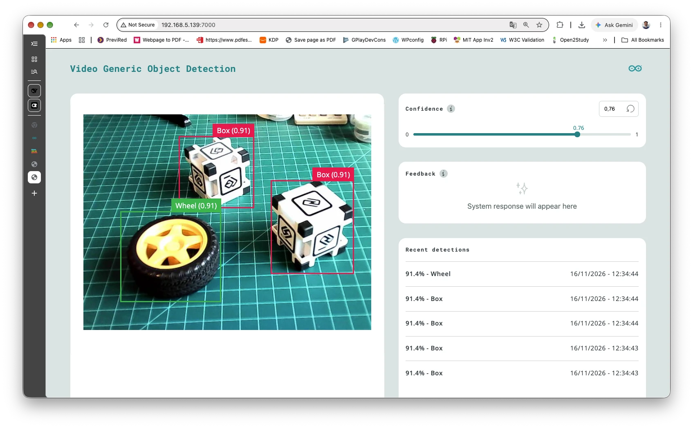

This screenshot was taken with YOLO-Pro Small, before we switched to Nano. With the threshold at 0.76, the model finds the two boxes and the wheel, each with a tight bounding box at about 0.91 confidence. The **Box** and **Wheel** labels confirm that the video Brick is running our `.eim` file: `EI_V_OBJ_DETECTION_MODEL` took effect, even though it is not among the Brick's declared variables.

> **Note:** The web page's "special reactions" are keyed to COCO classes (cat, cup, and so on), so they never fire for `box` or `wheel`. That's expected.

### Step 4 — The `VideoObjectDetection` Class

Before we modify the code, here is what the Brick offers:

```python
class VideoObjectDetection(camera: BaseCamera | None = None,
                           confidence: float = 0.3,
                           debounce_sec: float = 0.0,
                           camera_preview: bool = False)
```

- **camera**: the camera to use. If `None`, the default USB camera is opened.
- **confidence**: minimum confidence (0.0 to 1.0) for a detection to reach your callbacks.
- **debounce_sec**: minimum time between two triggers **for the same label**. Useful for alarms ("a wheel appeared"), harmful for counting, where you want every frame. We keep it at 0.
- **camera_preview**: if `True`, a callback that declares a `frame` parameter also receives the current camera frame as JPEG bytes, without boxes drawn. Useful for saving snapshots of detections.

And two ways to receive detections:

- `on_detect("wheel", callback)`: called whenever a specific label appears. The callback can take no arguments, or one dict with `confidence` and `bounding_box_xyxy`. If a frame has three wheels, it is called three times.
- `on_detect_all(callback)`: called **once per frame** with all detections, grouped by label. This is the one we want for counting.

One behavior is not obvious from the API, and it matters for our project: **neither callback is called when a frame has no detections.** When the last box leaves the camera's view, your code receives nothing at all. It does not receive "zero boxes"; it simply stops hearing from the Brick. We deal with that in the next section.

---

## 10. Post-Processing: Counting and MCU Actuation via Bridge

We now have live detection running. In this section, we turn the detections into **counts per class** and send them to the MCU, which shows them on the LED matrix: **boxes on the left half, wheels on the right**, one 2×2 block per object.

### Architecture

```
USB Webcam -> VideoObjectDetection Brick -> on_detect_all(detections)
                                                    |
                                     counts = (len(box), len(wheel))
                                     stamped with the time of the frame
                                                    |
                         user_loop (every 100 ms): if no frame for 1 s -> counts = (0, 0)
                                                    |  (only when the counts change)
                                  Bridge.call("show_counts", boxes, wheels)
                                                    |
                                          MCU (Arduino sketch)
                                          -> LED matrix:  ■ ■ ■ | ■ ■ ■
                                                          boxes  | wheels
```

Two design decisions are worth explaining:

- **The callback does not call the Bridge.** `on_detect_all` runs on a pool of worker threads, several frames per second. If it called the MCU directly, calls could overlap and arrive out of order. Instead, the callback only **records** the latest counts, under a lock. A single `user_loop` reads them and is the only code that talks to the MCU.
- **"Nothing seen" is a timeout.** Since the Brick is silent when a frame is empty, the loop treats "no detections for 1 second" as "zero objects". Without this, the matrix would freeze on the last count forever after the objects were removed. This is the most common bug in live detection apps, and it is easy to miss in testing, because you usually test by putting objects *in front of* the camera.

> **Match the timeout to your model.** The timeout must be longer than the time between two frames, or the count drops to zero between every pair of frames and the matrix blinks. A good rule is about three times the time between frames. Live, our models deliver a new frame every 100 ms (FOMO), 130 ms (YOLO-Pro Nano), or 300 ms (YOLO-Pro Small), as Section 11 shows, so one second covers all of them. If your live stream turns out slower, for example with a larger model, raise `EMPTY_AFTER_SEC` accordingly.

### Step 1 — Add a Sketch to the Project

```bash
cd ~/ArduinoApps/box-wheel-counter
mkdir -p sketch
```

### Step 2 — Write the Arduino Sketch

Create `sketch/sketch.ino`:

```cpp
#include "Arduino_RouterBridge.h"
#include "Arduino_LED_Matrix.h"

ArduinoLEDMatrix matrix;

// 8 rows x 13 columns, 0 = off, 1 = on.
// Row 0 is the top row, column 0 is the left column.
uint8_t frame[8][13];

const int MAX_PER_SIDE = 12;   // 3 blocks across x 4 blocks down
const int DIVIDER_COL  = 6;
const int BOX_BASE_COL   = 0;  // columns 0..5
const int WHEEL_BASE_COL = 7;  // columns 7..12

// Light a 2x2 block for the k-th object (k = 0..11) on one side.
void drawBlock(int k, int baseCol) {
  int row = (k / 3) * 2;
  int col = baseCol + (k % 3) * 2;
  frame[row][col]         = 1;
  frame[row][col + 1]     = 1;
  frame[row + 1][col]     = 1;
  frame[row + 1][col + 1] = 1;
}

void show_counts(int boxes, int wheels) {
  memset(frame, 0, sizeof(frame));

  for (int r = 0; r < 8; r++) frame[r][DIVIDER_COL] = 1;   // the divider shows the app is alive

  boxes  = constrain(boxes,  0, MAX_PER_SIDE);
  wheels = constrain(wheels, 0, MAX_PER_SIDE);
  for (int k = 0; k < boxes;  k++) drawBlock(k, BOX_BASE_COL);
  for (int k = 0; k < wheels; k++) drawBlock(k, WHEEL_BASE_COL);

  matrix.renderBitmap(frame, 8, 13);
}

void setup() {
  matrix.begin();
  show_counts(0, 0);

  Bridge.begin();
  // provide_safe runs the handler in the loop() context, where hardware
  // calls such as renderBitmap are safe (see the Agentic AI chapter).
  Bridge.provide_safe("show_counts", show_counts);
}

void loop() {
  // All work is event-driven via Bridge calls from Python.
}
```

Create `sketch/sketch.yaml`:

```yaml
profiles:
  default:
    fqbn: arduino:zephyr:uno_q
    platforms:
      - platform: arduino:zephyr
    libraries:
      - dependency: Arduino_RPClite (0.2.1)
default_profile: default
```

> As in the [Agentic AI chapter](../5-Agentic_AI/README.md), `Arduino_LED_Matrix` is bundled with the `arduino:zephyr` core and needs no `libraries:` entry. If the left and right halves appear swapped or upside down on your board, it's an orientation issue; the fix described in that chapter applies here unchanged.

### Step 3 — Update the Python Script

Replace `python/main.py`. It keeps the browser features of the original example (live detection list and threshold slider) and adds counting and the Bridge:

```python
import threading
import time
from datetime import datetime, UTC

from arduino.app_utils import App, Bridge
from arduino.app_bricks.web_ui import WebUI
from arduino.app_bricks.video_objectdetection import VideoObjectDetection

# Labels exactly as the model reports them (check "labels" in the model info
# printed in Section 8; if they are "0" and "1", use those strings here).
BOX_LABEL = "Box"
WHEEL_LABEL = "Wheel"

CONFIDENCE = 0.5
EMPTY_AFTER_SEC = 1.0   # no detections for this long -> counts are zero
                        # (about 3x the time between frames; 1.0 covers FOMO and both YOLO-Pro models)
LOOP_PERIOD_SEC = 0.1

ui = WebUI()
detection_stream = VideoObjectDetection(confidence=CONFIDENCE, debounce_sec=0.0)

ui.on_message("override_th",
              lambda sid, threshold: detection_stream.override_threshold(threshold))

# Shared between the detection callback (worker threads) and user_loop
state_lock = threading.Lock()
latest_counts = (0, 0)
last_detection_time = 0.0

shown_counts = None     # what the MCU is currently displaying (user_loop only)


def on_all_detections(detections: dict):
    """Called once per frame that has at least one detection."""
    global latest_counts, last_detection_time

    counts = (len(detections.get(BOX_LABEL, [])),
              len(detections.get(WHEEL_LABEL, [])))
    with state_lock:
        latest_counts = counts
        last_detection_time = time.monotonic()

    # Keep the original example's live list in the browser
    for label, values in detections.items():
        for value in values:
            ui.send_message("detection", message={
                "content": label,
                "confidence": value.get("confidence"),
                "timestamp": datetime.now(UTC).isoformat(),
            })


detection_stream.on_detect_all(on_all_detections)


def loop():
    """The only place that talks to the MCU."""
    global shown_counts

    with state_lock:
        if time.monotonic() - last_detection_time > EMPTY_AFTER_SEC:
            counts = (0, 0)          # the Brick is silent on empty frames
        else:
            counts = latest_counts

    if counts != shown_counts:
        try:
            Bridge.call("show_counts", counts[0], counts[1])
            shown_counts = counts
            print(f"==> boxes: {counts[0]}  wheels: {counts[1]}", flush=True)
        except Exception as e:
            print(f"Bridge call failed: {e}", flush=True)

    time.sleep(LOOP_PERIOD_SEC)


App.run(user_loop=loop)
```

A few details:

- `shown_counts` starts as `None`, so the first pass of the loop always sends the counts, even if they are `(0, 0)`. That re-synchronizes the matrix if the Python side restarts while the sketch keeps running.
- `shown_counts` is updated only **after** a successful call. If the MCU is momentarily unreachable, the loop tries again on the next pass.
- `App.run(user_loop=loop)` calls `loop()` repeatedly. As explained in the Agentic AI chapter, the Bridge is up by the time `loop()` first runs, which is why the Bridge call lives there and not above `App.run()`.

### Step 4 — Verify the Project Structure

```bash
box-wheel-counter/
├── app.yaml
├── assets/          # web page from the original example
├── python/
│   └── main.py
└── sketch/
    ├── sketch.ino
    └── sketch.yaml
```

### Step 5 — Run the Complete System

```bash
cd ~/ArduinoApps/box-wheel-counter
arduino-app-cli app stop .
arduino-app-cli app start .
```

> **Note**: The first run after adding the sketch takes longer, as the system compiles and flashes the Arduino code for the MCU.

### Step 6 — Test the System

Follow the logs:

```bash
arduino-app-cli app logs . --follow
```

Then work through these cases, in this order:

1. **One box** in view → one block lights on the left; the log shows `boxes: 1  wheels: 0`.
2. **Add two wheels** → two blocks light on the right.
3. **Remove everything** → after about one second, the matrix returns to just the divider. If it does not, the empty-frame timeout is not working.
4. **Hold an object at the edge of the frame**, or tilt it until it is half hidden → the count may flicker between two values. That is the threshold and the model's uncertainty showing through, which we deal with in the exercises.

Here is the matrix with three different scenes in front of the camera. The divider column is always on. Boxes fill the left half and wheels the right, one 2×2 block per object.

<p>
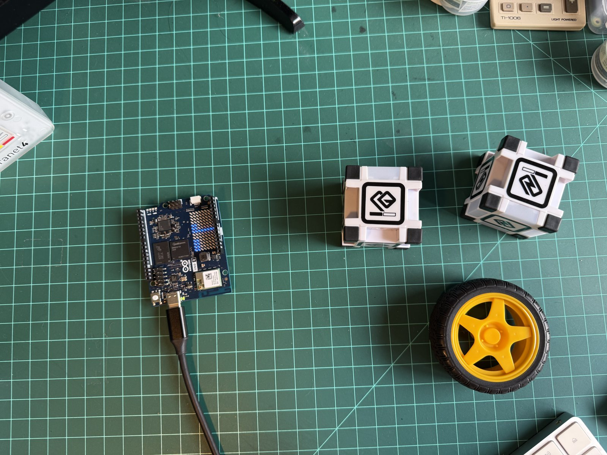
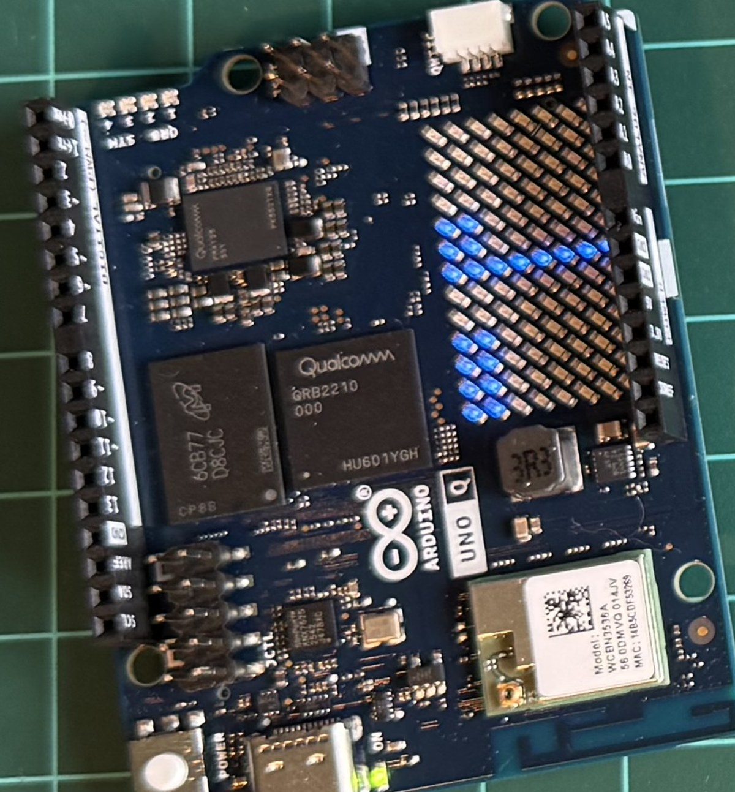
</p>

*Two boxes and one wheel: two blocks on the left of the divider, one on the right. Right: detail of the LED matrix in the same photo.*

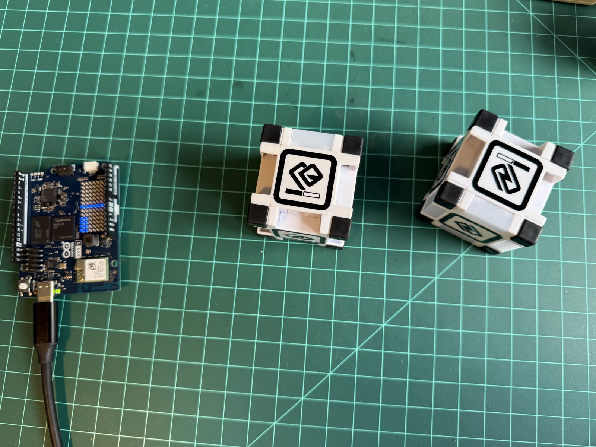

*Two boxes, no wheel: two blocks on the left, the right half is dark.*

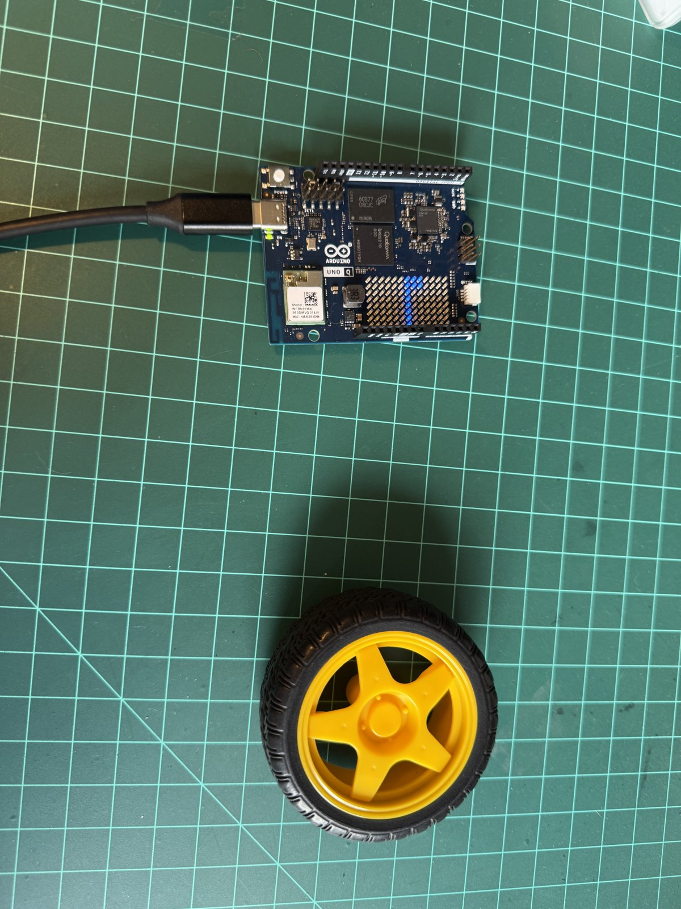

*One wheel, no box: a single block on the right of the divider.*

In the first two photos, the board is turned 90°, so the divider appears horizontal. In the third, the board is in its usual position and the divider is vertical. The layout on the board is the same.

### Step 7 — Stop the App

```bash
arduino-app-cli app stop .
```

### Extending the MCU Actuation

Because the MCU now receives numbers rather than a label, the sketch can react to quantities:

**Alarm when a batch is complete:**

```cpp
#define BUZZER_PIN 3
const int BATCH_SIZE = 4;

void show_counts(int boxes, int wheels) {
  // ... matrix drawing as before ...
  if (wheels >= BATCH_SIZE) tone(BUZZER_PIN, 2000, 200);
}
```

**Sort with a servo**, steering toward whichever class is in the majority:

```cpp
#include <Servo.h>
Servo gate;

void show_counts(int boxes, int wheels) {
  // ... matrix drawing as before ...
  if (boxes > wheels)      gate.write(0);
  else if (wheels > boxes) gate.write(180);
  else                     gate.write(90);
}
```

---

## 11. Performance Analysis

### Inference Latency

We measured all three models on the same UNO Q (4 GB) in two ways:

- **Path A (per image):** a small app called `ObjectDetection.detect()` on six 320×240 images from the dataset, five rounds after one warm-up call, and timed each call in Python. This is the end-to-end time your code waits, including the transfer to the model runner.
- **Path B (live stream):** with the Video Object Detection Brick running, we counted the result messages that the model runner sends for each camera frame over 30 seconds.

| Model | Input | Path A latency (mean of 30, after warm-up) | Warm-up call | Path B live FPS | Test metric |
|---|---|---|---|---|---|
| FOMO MobileNetV2 0.35 (float32) | 160×160 | 139 ms | 260 ms | ~10 FPS (camera limit) | F1 = 0.82 |
| YOLO-Pro Small (6.9M, int8) | 320×320 | 342 ms | 612 ms | 3.3 FPS | mAP@0.5 = 0.99 |
| YOLO-Pro Nano (2.4M, int8) | 320×320 | 221 ms | 454 ms | ~7.6 FPS | mAP@0.5 = 0.99 |
| YOLOX-Nano (pre-installed, COCO) | 416×416 | 534 ms | 786 ms | 1.7 FPS | n/a |

The Path A numbers agree with the ones from the browser uploads in Section 8 (about 160 ms and 331 ms). A few things stand out:

- **FOMO runs faster than the camera.** The Brick asks the camera for 10 FPS (the log says `throttling to requested 10 FPS`), and FOMO keeps up with every frame: the runner reports about 23 ms of processing per frame. The rest of the 139 ms in Path A is the trip from Python to the runner and back, not the model.
- **YOLO-Pro Small gives about 3 counts per second**, enough for objects sitting on a bench, and is faster than the pre-installed YOLOX-Nano, which has a larger input and 80 classes.
- **YOLO-Pro Nano more than doubles the live frame rate of Small** (about 7.6 against 3.3 FPS) with the same validation mAP@0.5. In Path A the gain looks smaller (221 against 342 ms), because about 115 ms of every call is the fixed trip to the runner, the same for every model.
- **The first call is always slower.** Ignore it when you measure.

To measure the live frame rate yourself, start the video app and run this script inside its container. It opens a second connection to the runner and counts results for 30 seconds:

```python
# fps.py: run with  docker exec -i <app>-main-1 python - < fps.py
import json, time
from websockets.sync.client import connect

with connect("ws://ei-video-obj-detection-runner:4912") as ws:
    stamps = []
    end = time.monotonic() + 30
    while time.monotonic() < end:
        msg = json.loads(ws.recv(timeout=10))
        if msg.get("type") == "classification":
            stamps.append(time.monotonic())

frames = len(stamps) - 1
print(f"{frames / (stamps[-1] - stamps[0]):.2f} FPS")
```

Unlike the `on_detect_all` callback, which stays silent on empty frames, the runner sends a result for every frame, so the count is correct whether or not objects are in view. (Our live measurements were taken with an empty scene.)

### Choosing Between FOMO and YOLO

| Aspect | FOMO | YOLO |
|---|---|---|
| **Output** | Centroid (drawn as a circle) | Fitted bounding box |
| **Speed: Edge Impulse estimate** | ~11 ms | ~1,841 ms |
| **Speed: measured on the UNO Q (Path A, end to end)** | ~139 ms | ~342 ms |
| **Live frame rate (Path B)** | ~10 FPS (camera limit) | 3.3 FPS |
| **Correct counts (6 test images)** | 2 of 6 | 6 of 6 |
| **Small objects** | Good (fine grid) | Depends on input resolution |
| **Touching objects** | May merge into one | Separates them better |
| **Object size / extent** | Not available | Available |
| **Best for** | Counting, presence, rough position | Measuring, cropping, overlap, tracking |

For this project, the measurements decide it: YOLO-Pro Nano counted every test image correctly and runs at about 7.6 frames per second live, which is why the live counter uses it. YOLO-Pro Small counted just as well but at 3.3 FPS. FOMO is faster still but miscounted four of six images. FOMO remains the right choice when objects are small and well separated, or when the hardware is much weaker than the UNO Q, as on a microcontroller. A good rule: start with the model your accuracy requirement allows, then check that the latency **measured on the board** fits your application, without relying on the estimate.

### Path A vs. Path B Comparison

| Aspect | Path A (Object Detection Brick) | Path B (Video Object Detection Brick) |
|---|---|---|
| **Input** | Static images (browser upload) | Live webcam (continuous) |
| **Output to Python** | Full result dict from `detect()` | Callbacks, grouped by label |
| **Confidence format** | String, 0–100 (`"87.50"`) | Float, 0.0–1.0 |
| **Annotated image** | `draw_bounding_boxes()` in Python | Rendered by the model runner (port 4912) |
| **Empty frames** | Returns an empty `detection` list | No callback at all |
| **MCU actuation** | Not included | Yes, via Bridge RPC |
| **Best for** | Checking a model, demos | Real-time applications |

### Comparison with the Raspberry Pi

The same dataset was trained for the Raspberry Pi in [EdgeML Made Easy](https://mjrovai.github.io/EdgeML_Made_Ease_ebook/). There, an SSD MobileNetV2 (320×320) took roughly 0.5 to 1.3 s per image on a Raspberry Pi Zero 2 W, and moving to FOMO cut the latency dramatically. On the UNO Q, at the same 320×320 input, YOLO-Pro Small takes about 0.34 s per image end to end (3.3 FPS live) and YOLO-Pro Nano about 0.22 s (about 7.6 FPS live), and FOMO's own processing takes about 23 ms per frame. The UNO Q pipeline adds the hop to the model runner, so compare **end-to-end** times measured on each board, not Edge Impulse's estimates, before drawing conclusions about the hardware.

---

## 12. Exercises

1. **Train your own dataset**: Capture and label about 60 images of objects on your own bench (Option B in Section 6). Train YOLO-Pro Nano on it and compare it with the model trained on the Roboflow dataset. Which one counts better on *your* bench, and why?

2. **Threshold sweep**: In the live app, try thresholds of 0.3, 0.5, and 0.7. For each, count false positives (blocks lit with no object) and false negatives (objects not counted) over one minute with a fixed arrangement of objects. Which threshold would you ship?

3. **Stabilize the count**: The count flickers when an object is at the edge of the frame. Modify `main.py` so the MCU shows the **most frequent** count over the last N frames (a mode filter) instead of the latest one. How large must N be before the flicker stops, and how much slower does the display react when you add or remove an object?

4. **Left or right?**: Use `bounding_box_xyxy` to decide whether each wheel is on the left or the right half of the image, and show the result on the matrix instead of the class split. Where is "the middle"? In Section 8, the static Brick returned coordinates in the uploaded image's pixels, not the model's 160×160. Check which space the video Brick uses before you hard-code a value: print a few boxes while moving an object from one edge of the frame to the other.

5. **Log to CSV**: Log each change in the counts (timestamp, boxes, wheels) to a CSV file on the UNO Q. After 5 minutes of adding and removing objects, plot the counts over time.

6. **Snapshot on detection**: Create the detector with `camera_preview=True` and declare `def on_all_detections(detections, frame)`. Save a JPEG whenever the wheel count reaches 3. These snapshots are also a cheap way to collect new training data from the real deployment.

7. **FOMO vs. YOLO on touching objects**: Place two wheels so that they touch. Compare how both models count them.

---

## 13. Conclusion

In this tutorial, we moved from *what* the camera sees to *where*, and *how many*:

1. **Part 1** — The pre-installed YOLOX-Nano detector, first on uploaded images (Object Detection Brick) and then on a live camera feed (Video Object Detection Brick), with the annotated video streamed to the browser.
2. **Path A** — Our own box-and-wheel detector, trained in Edge Impulse as both FOMO and YOLO, checked on static images, with the model info, detections, and latency printed in the log.
3. **Path B** — The same model on the live camera, with detections turned into counts per class and sent over Bridge RPC to the MCU, which displays them on the LED matrix.

### Key Takeaways

- **Detection = classification + localization.** It is evaluated with IoU and mAP, not accuracy alone, and the confidence threshold is the main knob that trades false positives for false negatives.
- **FOMO and YOLO answer different questions.** FOMO gives you where, fast. YOLO adds how big, and on our test images it also counted far more reliably, at two to three times the latency. Choose by the information and accuracy your application needs.
- **Measure on the board, not in the estimate.** Edge Impulse's latency estimates missed in both directions (11 ms vs. 160 ms measured for FOMO, 1,841 ms vs. 331 ms for YOLO).
- **The Bricks hide the inference pipeline**, including NMS and drawing, so the engineering moves to what you do with the detections.
- **Live detection needs an explicit "nothing seen" state.** The Video Object Detection Brick is silent on empty frames; a timeout turns that silence into "zero".
- **Keep hardware calls in one place.** Callbacks record state; a single loop talks to the MCU, and only when something changed.

### What's Next

This chapter closes the Fixed-Function part of the book. Detection is also where the two halves of the book meet: a fast detector can find *where* to look, and the vision-language model from the [Multimodal AI chapter](../3-Multimodal_AI_Edge/README.md) can then describe *what* is there, on a crop instead of the whole frame, at a fraction of the cost. Building that pipeline is a natural next project.

---

## 14. Resources

| Resource | URL |
|---|---|
| Edge Impulse Studio | https://studio.edgeimpulse.com |
| This chapter's Edge Impulse project (public) | https://studio.edgeimpulse.com/public/894640/live |
| EI Arduino UNO Q Docs | https://docs.edgeimpulse.com/hardware/boards/arduino-uno-q |
| EI App Lab Deployment | https://docs.edgeimpulse.com/hardware/deployments/run-arduino-app-lab |
| EI Object Detection (FOMO) | https://docs.edgeimpulse.com/docs/edge-impulse-studio/learning-blocks/object-detection/fomo-object-detection-for-constrained-devices |
| App Lab Bricks (source and docs) | https://github.com/arduino/app-bricks-py |
| App Lab examples (source) | https://github.com/arduino/app-bricks-examples |
| Box-versus-wheel dataset (Roboflow) | https://universe.roboflow.com/marcelo-rovai-riila/box-versus-wheel-auto-dataset |
| EdgeML Made Easy (Raspberry Pi) | https://mjrovai.github.io/EdgeML_Made_Ease_ebook/ |
| Image Classification Tutorial | [Previous chapter](../6-Image_Classification/README.md) |

---

*A first draft of this chapter's text and code was generated by Claude Opus 5.5 (Anthropic) under the author's direction, then tested and measured on the author's UNO Q.*

*Tutorial created for IESTI05 — Edge AI ML System Engineering, UNIFEI. Licensed under CC-BY-SA 4.0.*
