# RAG at the Edge:

Giving a Small Model a Library


> **Course materials for this chapter** — [slide deck](https://github.com/Mjrovai/UNIFEI-IESTI05-EDGE_AI/blob/main/00_Curso_Folder/4-Generative_AI-UNO-Q/6-RAG-at-the-Edge/Ch6-RAG-at-the-Edge.pdf) · [video walkthrough, 27:47](https://youtu.be/fzZpUFOH62k) (*Chapter 6* of the [IESTI05 lecture series](https://www.youtube.com/playlist?list=PLesj_E3B3AQQ)).

---

## 1. Introduction

### What This Chapter Covers

Ask Qwen3.5-0.8B how long the dengue virus must incubate inside a mosquito before the mosquito becomes infective, and here is what it said on the UNO Q:

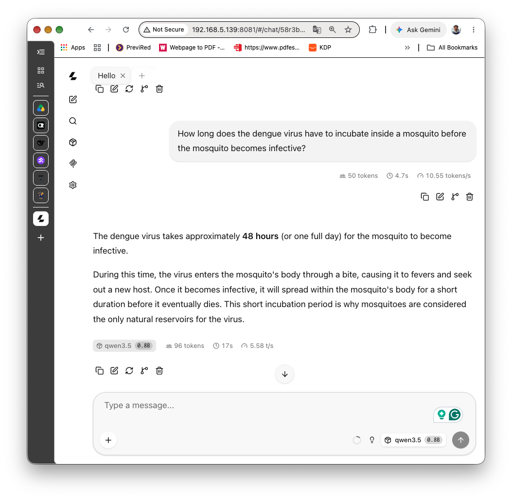

"...approximately **48 hours** (or one full day)..." Oops. A full day is 24 hours, not 48, and the answer is wrong anyway: the guidelines give 8 to 12 days. The answer is fluent, confident, formatted, and wrong. Now give the same model one sentence from a reference text along with the question:

```
  0.90  Inside the mosquito, the virus needs 8 to 12 days before it can be tra...

The virus requires 8 to 12 days inside the mosquito for transmission, though warmer
temperatures shorten this time.

retrieval 0.11 s | prompt 177 tokens in 15.2 s | answer 24 tokens in 4.2 s
```

That is **Retrieval-Augmented Generation (RAG)**: before the model answers, a search step finds the passages of a document collection that are most relevant to the question, and pastes them into the prompt. The model stops answering from its (small, fuzzy) memory and starts answering from text you chose.

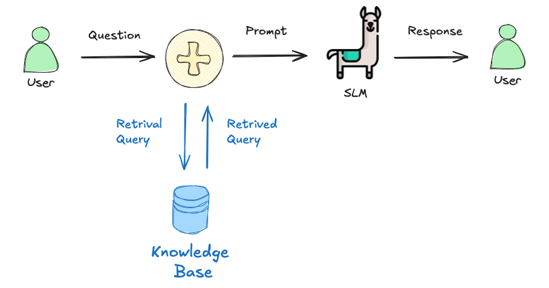

RAG matters more at the edge than anywhere else. A 0.8B-parameter model (SLM) has room for grammar and general knowledge, not for the details of a 160-page medical guideline (Knowledge Base). Fine-tuning it on that guideline is out of reach on a board with four Cortex-A53 cores. Retrieval, on the other hand, is cheap: in this chapter the search itself takes about 0.15 s. The expensive part on the UNO Q turns out to be something else, and finding it is half of what this chapter is about.

The chapter covers two parts:

- **Part 1: RAG at the Edge** (Sections 2 to 7): what embeddings are, how to serve an embedding model with `llama-server`, and a complete RAG in about 100 lines of Python over a small list of dengue facts.
- **Part 2: a hands-on RAG application, plus advanced techniques** (Sections 8 to 14): a persistent knowledge base built from a real 160-page PDF, the WHO *Dengue: Guidelines for diagnosis, treatment, prevention and control*, then measuring and improving it: retrieval quality, chunk size against latency, hybrid keyword + vector search, "I don't know" thresholds, reranking, and an agentic RAG that decides on its own when to search and when to calculate.

The dengue theme is deliberate. [GenAI Meets the Real World](../4-Gen_AI_Edge/README.md) built a dengue *risk classifier* from sensor readings, and [Multimodal AI at the Edge](../3-Multimodal_AI_Edge/README.md) described mosquito-breeding images. This chapter gives the same small model a library to consult.

**Why this approach?**

- **No new Python packages.** Everything runs with `requests` (already in the UNO Q's Debian image) and the standard library: `sqlite3` is the vector store, `array` holds the vectors, and a dot product is the search. No ChromaDB, no LangChain, no NumPy.
- **No new inference engine.** The embedding model is a GGUF file served by the same `llama-server` binary you built in [chapter 2](../2-Gen_AI/README.md), on a second port.
- **Every number in this chapter was measured on the board**, so you know what to expect before you start, and where the time goes.

> **This chapter is not medical advice.** The WHO document is used as a realistic technical corpus for teaching retrieval. It dates from 2009, and parts of it (vaccines, for example) are out of date. Section 12.3.1 uses that on purpose.

### Prerequisites

This tutorial assumes you have completed:

- [Setup](../1-Setup/README.md) — SSH access to the board.
- [Generative AI at the Edge](../2-Gen_AI/README.md) — `llama.cpp` built from source, Qwen3.5-0.8B (Q8_0) downloaded, and `llama-server` running on port 8081.
- [Agentic AI at the Edge](../5-Agentic_AI/README.md) — only for Section 13 (agentic RAG), which reuses its tool-calling loop.

## 2. Why a Small Model Needs a Library

A language model stores what it learned during training in its weights. For a 0.8B model, that storage is small and lossy: it knows that dengue is spread by mosquitoes, and roughly what the symptoms are, because those facts appear thousands of times on the web. It does not know that the WHO guidelines classify patients into Groups A, B, and C, or how the Breteau index is computed, or what the extrinsic incubation period is. When asked, it does not say "I don't know." It produces the most plausible-sounding continuation, which is how a mosquito ends up transmitting rabies.

There are three ways to give a model knowledge it lacks:

| Approach | What changes | Cost on the UNO Q |
|---|---|---|
| **Bigger model** | More parameters, more memory | The 2B already halves the speed; 4B does not fit comfortably |
| **Fine-tuning** | The weights | Training is not realistic on four A53 cores; done elsewhere, it must be redone for every document update |
| **RAG** | Only the prompt | One small embedding model (~100 MB of RAM) and a search; documents can change any time |

RAG has a second advantage that matters in practice: **traceability**. Because the answer is built from retrieved passages, the system can show which passages it used (Section 10 prints the WHO section numbers next to every answer), and a reader can check them.

## 3. How RAG Works

The pipeline has two phases. The **indexing** phase runs once, or whenever the documents change. The **query** phase runs for every question.

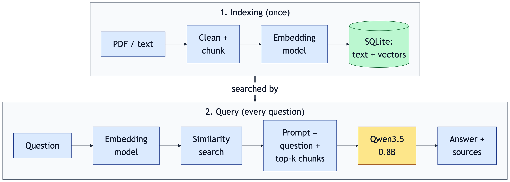

<!-- Diagram source: images/png/rag-pipeline.mmd (Mermaid; render with Quarto mermaid-format: png). -->

1. **Chunking.** Documents are split into passages short enough to embed and to fit in the prompt (here, at most 180 words).
2. **Embedding.** An *embedding model* turns each chunk into a vector, a list of a few hundred numbers. Chunks that mean similar things get vectors that point in similar directions.
3. **Storage.** The vectors are stored next to the text. That is all a "vector database" is.
4. **Retrieval.** The question is embedded with the same model, and the chunks whose vectors are closest to the question's vector are retrieved.
5. **Augmentation and generation.** The retrieved chunks are pasted into the prompt, and the SLM answers from them.

### Embeddings, briefly

[How Generative AI Works](https://mjrovai.github.io/genai-uno-q/content/foundations/foundations.html) introduced embeddings as the vectors a language model uses internally for each token. An **embedding model** applies the same idea to whole sentences: it is a small transformer (usually a BERT-style encoder) trained so that a question and the passage that answers it end up close together. The models used here have 23 to 600 million parameters and output 384 to 1024 numbers per text.

"Close" is measured with **cosine similarity**, the cosine of the angle between two vectors: 1 means the same direction, 0 means unrelated. `llama-server` returns vectors already scaled to length 1, so the cosine is simply the dot product, a sum of products, which is what the scripts in this chapter compute.

## 4. Hardware and Software Requirements

### Hardware

- Arduino UNO Q **4 GB**.
- Nothing else: no sensors or wiring.

### Software (already on the UNO Q from earlier chapters)

| Tool | Purpose |
|---|---|
| `llama.cpp` built from source | `llama-server` serves both the SLM and the embedding model |
| Qwen3.5-0.8B Q8_0 GGUF | The generator |
| Python 3.13 with `requests` | Ships with the Debian image |

### Software (installed in this chapter)

| Tool | Purpose |
|---|---|
| `bge-small-en-v1.5` GGUF (37 MB) | The embedding model |
| `poppler-utils` (`pdftotext`) | Extracts text from the WHO PDF (Part 2) |
| `jina-reranker-v1-tiny-en` GGUF (37 MB) | Optional reranker (Section 12.4) |

> **No `pip install` in this chapter.** The current UNO Q image ships without `pip` and marks its Python as "externally managed", so packages cannot be installed system-wide without extra steps. `requests` is preinstalled, and `sqlite3`, `array`, `json`, and `ast` are in the standard library, which is all the code needs.

### Two Servers, Not One

A `llama-server` process loads one model. RAG needs two (one to embed, one to generate), so this chapter runs two processes side by side:

| Port | Model | Role | RAM (process RSS) |
|---|---|---|---|
| 8081 | Qwen3.5-0.8B Q8_0 | Generates answers | ~1.0 GB |
| 8082 | bge-small-en-v1.5 Q8_0 | Embeds chunks and questions | ~75–100 MB |

With both running, `free -m` showed about 2.8 GB still available. The embedding model costs less RAM than a browser tab.

## 5. Serving an Embedding Model

### Step 1 — Download the Embedding Model

```bash
mkdir -p ~/models/embed
cd ~/models/embed
wget -c https://huggingface.co/CompendiumLabs/bge-small-en-v1.5-gguf/resolve/main/\
bge-small-en-v1.5-q8_0.gguf
```

### Step 2 — Start It With `--embedding`

```bash
~/llama.cpp/build/bin/llama-server \
  --model ~/models/embed/bge-small-en-v1.5-q8_0.gguf \
  --embedding \
  --port 8082 \
  --threads 4 \
  --ctx-size 2048 --batch-size 2048 --ubatch-size 2048 \
  --alias bge-small
```

- `--embedding` turns the server into an embedding service: it exposes the OpenAI-compatible `/v1/embeddings` endpoint and refuses chat requests.
- `--ubatch-size 2048`: an encoder model like BGE reads the whole text at once (it is not causal), so the entire input must fit in one micro-batch. With a small `--ubatch-size`, longer chunks fail with an error.
- `--ctx-size 2048`: the server splits this among its parallel slots (4 by default), giving 512 tokens per text, which is exactly what BGE was trained on. The startup warning `n_ctx_seq (2048) > n_ctx_train (512)` is harmless; the log line that follows shows `n_ctx_slot = 512`.

### Step 3 — Test It

```bash
curl -s http://127.0.0.1:8082/v1/embeddings \
  -H "Content-Type: application/json" \
  -d '{"input": ["Dengue is spread by Aedes mosquitoes."]}' \
  | python3 -c "import sys, json; d = json.load(sys.stdin); \
print(len(d['data'][0]['embedding']), d['usage'])"
```

Expected output: `384 {'prompt_tokens': 12, 'total_tokens': 12}` (the token count may vary slightly). The 384 is the vector's dimension.

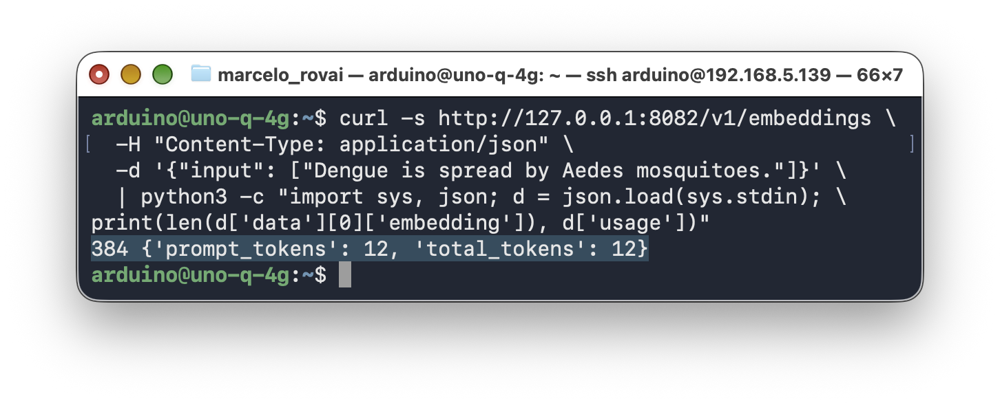

### A Script to Start Both Servers

From here on, both servers run in the background. Save this as `~/rag/start_rag_servers.sh`:

```bash
#!/usr/bin/env bash
# Start the two llama-server processes this chapter needs, in the background.
#   SLM (Qwen3.5-0.8B) on port 8081, embedding model (bge-small) on port 8082.
# Logs go to ~/rag/logs; stop both with: pkill llama-server
LLAMA=~/llama.cpp/build/bin/llama-server
SLM=${SLM:-~/models/Qwen_Qwen3.5-0.8B-Q8_0.gguf}
EMB=${EMB:-~/models/embed/bge-small-en-v1.5-q8_0.gguf}
mkdir -p ~/rag/logs

nohup "$LLAMA" --model "$SLM" --port 8081 --host 0.0.0.0 \
  --jinja --reasoning off --reasoning-budget 0 \
  --ctx-size 4096 --threads 4 --batch-size 512 --ubatch-size 64 \
  --predict 1024 --alias qwen3.5-0.8b > ~/rag/logs/slm.log 2>&1 &

nohup "$LLAMA" --model "$EMB" --port 8082 --embedding \
  --ctx-size 2048 --batch-size 2048 --ubatch-size 2048 --threads 4 \
  --alias bge-small > ~/rag/logs/embed.log 2>&1 &

for port in 8081 8082; do
  until curl -s localhost:$port/health | grep -q ok; do sleep 1; done
  echo "port $port ready"
done
```

```bash
mkdir -p ~/rag && cd ~/rag
chmod +x start_rag_servers.sh
./start_rag_servers.sh
```

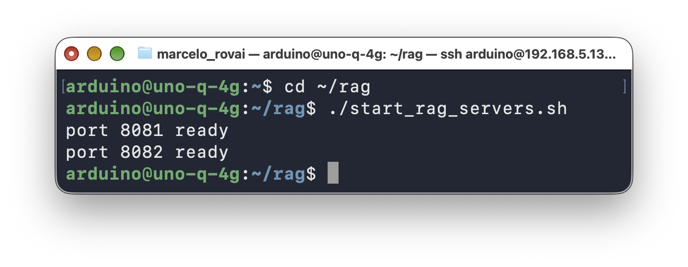

Both were ready in about 5 seconds. The SLM's flags are the ones from [Agentic AI at the Edge](../5-Agentic_AI/README.md), including `--jinja`, which Section 13 needs for tool calling.

> If you ran the systemd service from [GenAI Meets the Real World](../4-Gen_AI_Edge/README.md), it already holds port 8081. Stop it first with `sudo systemctl stop llama-server`, or skip the first `nohup` block and use the service.

### Which Embedding Model?

Embedding models range from tiny to larger than the SLM itself. All six below were measured on the UNO Q embedding the same 32 chunks of the WHO guidelines (4 threads, Q8_0 quantization, batches of 8 chunks). "Full index" is the time to embed all 373 chunks of the 160-page document.

| Model | Params | Dim | Embedding speed | RAM (RSS) | Full index |
|---|---|---|---|---|---|
| `all-MiniLM-L6-v2` | 23M | 384 | **414 tok/s** | 82 MB | **~3 min** |
| `bge-small-en-v1.5` | 33M | 384 | 209 tok/s | 97 MB | ~6 min |
| `multilingual-e5-small` | 118M | 384 | 212 tok/s | 217 MB | ~6 min (see note) |
| `nomic-embed-text-v1.5` | 137M | 768 | 53 tok/s | 242 MB | ~26 min |
| `embeddinggemma-300M` | 300M | 768 | 47 tok/s | 431 MB | ~32 min |
| `Qwen3-Embedding-0.6B` | 600M | 1024 | 14 tok/s | 983 MB | ~2 hours |

Two things stand out. First, the cost grows much faster than the parameter count suggests: `nomic-embed-text`, the default in the Raspberry Pi version of this tutorial, is about 4× slower than BGE-small on the A53. Second, the large multilingual models that top the leaderboards are not practical for indexing on this board: Qwen3-Embedding-0.6B would need two hours and a gigabyte of RAM for one book.

This chapter uses **bge-small-en-v1.5**: it is small, fast enough to index a book in minutes, and Section 11 shows its retrieval quality is good. MiniLM is twice as fast and a reasonable choice when indexing time matters more than accuracy.

> **Always sanity-check an embedding model before indexing.** Both `multilingual-e5-small` GGUF conversions tried for this chapter failed on the UNO Q. One returned almost identical vectors for every input (cosine 0.93 between a question and its answer, and 0.89 between the same question and a bread recipe), and the other crashed `llama-server` at load. Retrieval with the first one found the right passage for 0 of 17 test questions. The fix is a ten-second test: embed one relevant and one unrelated pair, and check that the scores are clearly different. With BGE they were 0.89 and 0.54.

## 6. First Contact: What an Embedding Looks Like

With both servers running, create `~/rag/embed_demo.py`:

```python
#!/usr/bin/env python3
"""
What an embedding model does: turn sentences into vectors whose
dot product measures how close their meanings are.
Needs llama-server with an embedding model on port 8082.
"""
import requests

EMBED_URL = "http://127.0.0.1:8082/v1/embeddings"

sentences = [
    "Aedes aegypti mosquitoes lay their eggs in standing water.",
    "Mosquito larvae develop in water-filled containers such as old tyres.",
    "Dengue fever causes high fever and severe joint pain.",
    "The Arduino UNO Q has a quad-core Cortex-A53 processor.",
]

r = requests.post(EMBED_URL, json={"input": sentences}, timeout=60)
r.raise_for_status()
vectors = [d["embedding"] for d in r.json()["data"]]
print(f"{len(vectors)} vectors of {len(vectors[0])} numbers each")
print("first 5 numbers of sentence 1:", [round(x, 3) for x in vectors[0][:5]])

# llama-server returns unit-length vectors, so the dot product
# is the cosine similarity: 1 = same direction, 0 = unrelated.
def cosine(a, b):
    return sum(x * y for x, y in zip(a, b))

print("\nCosine similarity:")
for i in range(len(sentences)):
    for j in range(i + 1, len(sentences)):
        print(f"  {cosine(vectors[i], vectors[j]):.2f}  [{i + 1}] vs [{j + 1}]")
```

```bash
cd ~/rag
python3 embed_demo.py
```

Output on the UNO Q:

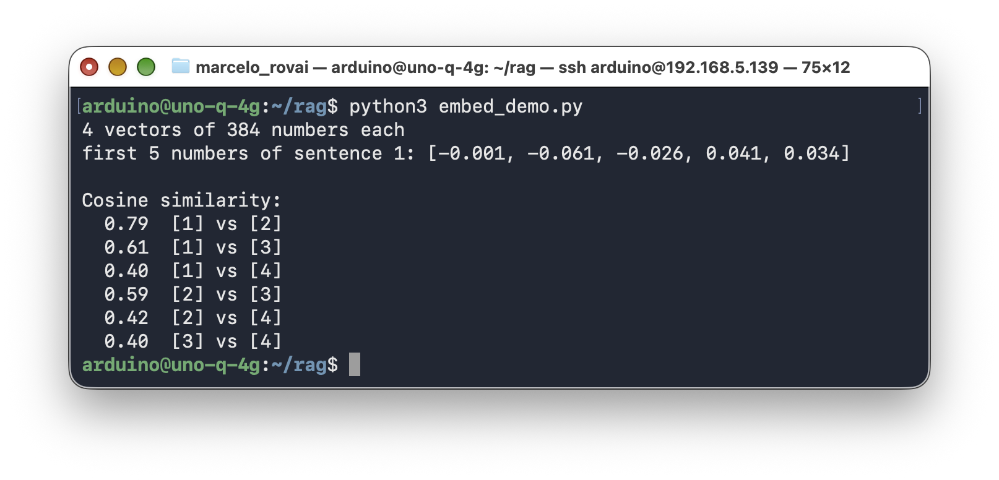

The two sentences about mosquito breeding (1 and 2) score 0.79, though they share almost no words: "lay their eggs in standing water" and "larvae develop in water-filled containers" mean nearly the same thing. The dengue-symptoms sentence is related but less close (~0.6), and the sentence about the UNO Q's processor is the outlier (~0.4). Note that "unrelated" is 0.4, not 0: with BGE, scores are relative, and only the ranking matters. That will matter again when we try to set a threshold in Section 12.3.

## 7. A Minimal RAG

The smallest useful RAG needs no database at all. `~/rag/rag_mini.py` keeps fifteen dengue facts in a Python list, embeds them at startup, and for each question retrieves the three closest facts and passes them to the SLM:

```python
#!/usr/bin/env python3
"""
A minimal RAG: a list of facts, an embedding model, a dot product,
and a small language model. No database, no framework.

  python3 rag_mini.py "When do Aedes aegypti mosquitoes bite?"
  python3 rag_mini.py --no-rag "When do Aedes aegypti mosquitoes bite?"

Needs llama-server twice: the SLM on port 8081 and an embedding
model on port 8082.
"""
import sys
import time

import requests

CHAT_URL = "http://127.0.0.1:8081/v1/chat/completions"
EMBED_URL = "http://127.0.0.1:8082/v1/embeddings"
MODEL = "qwen3.5-0.8b"
QUERY_PREFIX = "Represent this sentence for searching relevant passages: "  # bge-small

# ─── The knowledge base: one fact per entry, so each entry is a chunk ──
FACTS = [
    "Dengue is a viral infection transmitted to humans by the bite of infected "
    "female Aedes mosquitoes, mainly Aedes aegypti and, to a lesser extent, Aedes albopictus.",
    "There are four dengue virus serotypes, DEN-1 to DEN-4. Recovery from one gives "
    "lifelong immunity against that serotype only.",
    "A second infection with a different serotype increases the risk of severe dengue.",
    "After an infected bite, symptoms usually appear after an incubation period of 4 to 10 days.",
    "Aedes aegypti bites mainly during the day, with peaks in the early morning and "
    "in the late afternoon before dusk.",
    "Aedes aegypti lays its eggs on the damp inner walls of containers just above the "
    "water line. The eggs can survive dry for months and hatch when flooded.",
    "Common breeding sites are water-storage tanks, flower-pot saucers, discarded tyres, "
    "bottles, and any container that collects rainwater.",
    "The most effective prevention is removing standing water: cover, empty, or clean "
    "water containers every week.",
    "Inside the mosquito, the virus needs 8 to 12 days before it can be transmitted "
    "(the extrinsic incubation period); warmer temperatures shorten it.",
    "Typical dengue symptoms are high fever, severe headache, pain behind the eyes, "
    "muscle and joint pain, nausea, vomiting, and rash.",
    "Warning signs of severe dengue include abdominal pain, persistent vomiting, "
    "bleeding gums, lethargy or restlessness, and a rapid drop in platelet count.",
    "There is no specific antiviral treatment for dengue. Paracetamol is used for fever; "
    "aspirin and ibuprofen should be avoided because they can aggravate bleeding.",
    "Repellents containing DEET, IR3535, or icaridin protect exposed skin from mosquito bites.",
    "Small fish and predatory copepods that eat mosquito larvae have been used for "
    "biological control in water-storage containers.",
    "Ovitraps are small containers where mosquitoes lay eggs; counting the eggs is a "
    "cheap way to monitor Aedes populations.",
]

session = requests.Session()


def embed(texts):
    r = session.post(EMBED_URL, json={"input": texts}, timeout=120)
    r.raise_for_status()
    return [d["embedding"] for d in r.json()["data"]]


def dot(a, b):
    return sum(x * y for x, y in zip(a, b))


def chat(messages):
    r = session.post(CHAT_URL, json={
        "model": MODEL, "messages": messages, "max_tokens": 150,
        "temperature": 0.3, "top_p": 0.8, "presence_penalty": 1.5}, timeout=600)
    r.raise_for_status()
    data = r.json()
    return data["choices"][0]["message"]["content"].strip(), data["timings"]


# ─── Step 1: index the facts once (embed every chunk) ───────────────
t0 = time.perf_counter()
FACT_VECTORS = embed(FACTS)
print(f"Indexed {len(FACTS)} facts in {time.perf_counter() - t0:.1f} s\n")


def rag(question, k=3):
    # Step 2: embed the question with the same model
    t0 = time.perf_counter()
    q = embed([QUERY_PREFIX + question])[0]
    # Step 3: retrieve the k most similar facts
    ranked = sorted(zip(FACTS, FACT_VECTORS), key=lambda fv: dot(q, fv[1]), reverse=True)
    context = [f for f, _ in ranked[:k]]
    t_retrieve = time.perf_counter() - t0
    for f, v in ranked[:k]:
        print(f"  {dot(q, v):.2f}  {f[:70]}...")

    # Step 4: augment the prompt with the retrieved facts
    messages = [
        {"role": "system", "content": "Answer in at most three sentences, using only "
                                      "the facts provided. If they do not contain the "
                                      "answer, say you don't know."},
        {"role": "user", "content": "Facts:\n- " + "\n- ".join(context)
                                    + f"\n\nQuestion: {question}"},
    ]
    # Step 5: generate
    answer, tm = chat(messages)
    print(f"\n{answer}\n")
    print(f"retrieval {t_retrieve:.2f} s | prompt {tm['prompt_n']} tokens in "
          f"{tm['prompt_ms'] / 1000:.1f} s | answer {tm['predicted_n']} tokens in "
          f"{tm['predicted_ms'] / 1000:.1f} s")


if __name__ == "__main__":
    args = sys.argv[1:]
    if args and args[0] == "--no-rag":
        answer, tm = chat([{"role": "user", "content": " ".join(args[1:])}])
        print(f"{answer}\n\nprompt {tm['prompt_n']} tokens, answer {tm['predicted_n']} "
              f"tokens in {(tm['prompt_ms'] + tm['predicted_ms']) / 1000:.1f} s")
    else:
        rag(" ".join(args) or "When do Aedes aegypti mosquitoes bite?")
```

Each fact is one "chunk", so there is nothing to split. The query uses a prefix (`Represent this sentence for searching relevant passages: `) because BGE was trained that way: short questions and long passages are embedded asymmetrically. Other embedding models use other prefixes, and some (MiniLM) use none; Section 10's script keeps a table of them.

### Without RAG, Then With

```bash
python3 rag_mini.py --no-rag "How long does the virus need inside the mosquito before it can be transmitted?"
```

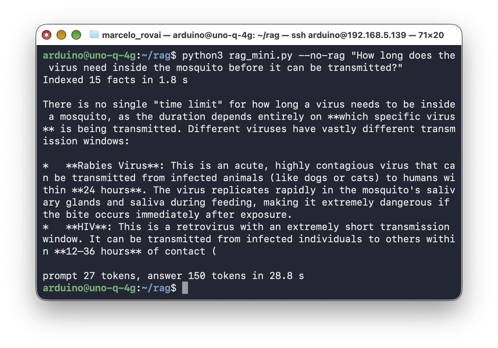

The answer is completely wrong: it lists rabies and HIV, which mosquitoes do not transmit, with invented transmission windows. That is 150 tokens of confident text in 28.8 s, and none of it is about dengue.

```bash
python3 rag_mini.py "How long does the virus need inside the mosquito before it can be transmitted?"
```

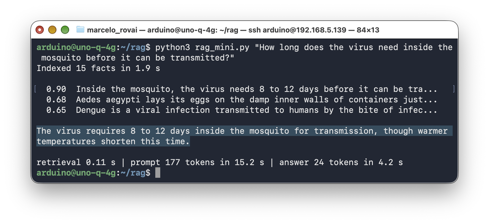

The right fact scored 0.90, far above the rest. The answer is correct, short, and faster than the hallucination because a model with the answer in front of it doesn't ramble.

### Where the Time Goes

The last line of the output is the most important lesson of Part 1. Retrieval (embedding the question and comparing it with 15 vectors) took 0.11 s. Generating 24 tokens took 4.2 s. **Reading the 177-token prompt took 15.2 s.**

On the UNO Q, the 0.8B model processes the prompt (*prefill*) at only about 11 tokens per second, barely twice its generation speed. On a desktop GPU, prefill is hundreds of times faster than generation, and RAG tutorials treat the retrieved context as free. Here, every word you paste into the prompt costs roughly 0.1 s before the first word of the answer appears. That single number shapes every design decision in Part 2: how big the chunks are, how many to retrieve, and whether a second LLM call (for validation, say) is affordable.

> `--ubatch-size` does not change this. `llama-bench` measured 11.0–11.6 tok/s prefill with `--ubatch-size 64` and 11.8–12.0 tok/s with 512, for 256- and 768-token prompts. Prefill on this board is compute-bound.

**End of Part 1.** You have embeddings, retrieval, augmentation, and generation working on the board, in about 100 lines. Part 2 makes it real: a document that does not fit in a Python list, a persistent index, and measurements to tune it.

## 8. The Knowledge Base: A 160-Page WHO Guideline

The document for Part 2 is the World Health Organization's [*Dengue: Guidelines for diagnosis, treatment, prevention and control*](https://iris.who.int/handle/10665/44188) (new edition, 2009): 160 pages covering epidemiology, clinical management, vector control, laboratory diagnosis, surveillance, and vaccine research. It is a realistic RAG target: long, technical, organized into numbered sections, and full of facts a 0.8B model does not know.


> **Copyright.** The guidelines are free to download from WHO, but WHO reserves all rights. This chapter does not reproduce them: you download your own copy, and the outputs shown here quote only short fragments.

### Step 1 — Download the PDF

WHO's repository serves the file through a JavaScript page, which tools like `wget` cannot follow, so use the direct file link from its API:

```bash
mkdir -p ~/rag/docs && cd ~/rag/docs
wget -O who_dengue_2009.pdf \
  "https://iris.who.int/server/api/core/bitstreams/b1db05d8-0e97-469e-b529-464dca6de540/content"
ls -lh who_dengue_2009.pdf      # about 1.5 MB
```

If the link ever stops working, open the [repository page](https://iris.who.int/handle/10665/44188) in a browser, download `9789241547871_eng.pdf`, and copy it to the board with `scp`.

### Step 2 — Extract the Text

PDFs are designed for printing, not for reading text back out of them. `pdftotext` from `poppler-utils` does a good job:

```bash
sudo apt install -y poppler-utils
pdftotext who_dengue_2009.pdf who_dengue_2009.txt
wc -w who_dengue_2009.txt       # 54,984 words
```

The extraction took 10 seconds on the UNO Q. Now look at what it produced:

```bash
sed -n 2020,2040p who_dengue_2009.txt
```

You will see the problems every PDF pipeline has to solve:

- **Running headers and page numbers** in the middle of sentences: the title *Dengue: Guidelines for diagnosis, treatment, prevention and control* and a bare `33` appear every page, splitting paragraphs in two.
- **Bullets on their own lines**, separated from their text by blank lines and tabs.
- **Hyphenation** at line ends, and lines broken mid-sentence.
- **Tables and figures** reduced to scattered words, or to nothing at all: several section headings have no text under them.
- **Reference lists**, which are dense with medical vocabulary and therefore *look* relevant to almost any medical question, while answering none.

Cleaning isn't glamorous, but it determines how well everything downstream works. A chunk that is half a page of header and half a reference list will confuse the model.

## 9. Building the Index

`~/rag/build_index.py` turns the text file into a persistent SQLite database in four stages: clean, split into sections, chunk, and embed.


<!-- Diagram source: images/png/build-index.mmd (Mermaid; render with Quarto mermaid-format: png). -->

The full script:

```python
#!/usr/bin/env python3
"""
Build a persistent RAG index from a text file extracted from a PDF.

  pdftotext who_dengue_2009.pdf who_dengue_2009.txt
  python3 build_index.py docs/who_dengue_2009.txt

Pipeline: clean the text -> split into numbered sections -> chunk ->
embed with llama-server (--embedding, port 8082) -> store in SQLite.
Only the standard library and `requests` are needed.
"""
import argparse
import re
import sqlite3
import sys
import time
from array import array

import requests

EMBED_URL = "http://127.0.0.1:8082/v1/embeddings"

# Some embedding models were trained with a prefix on each side.
# The same table lives in ask_dengue.py, so both scripts agree.
PREFIXES = {
    "bge-small":      ("Represent this sentence for searching relevant passages: ", ""),
    "minilm":         ("", ""),
    "e5-small":       ("query: ", "passage: "),
    "nomic-embed":    ("search_query: ", "search_document: "),
    "embeddinggemma": ("task: search result | query: ", "title: none | text: "),
}

# Embedded at build time and stored, so ask_dengue.py can check that the
# server it talks to is running the same embedding model.
PROBE = "Dengue is transmitted by Aedes mosquitoes."

RUNNING_HEADER = "Dengue: Guidelines for diagnosis, treatment, prevention and control"
SECTION_RE = re.compile(r"^(\d\.\d+(?:\.\d+)*)\s+([A-Z].{2,90})$")


# ─── 1. Cleaning: undo what the PDF layout did to the text ──────────
def clean_lines(raw):
    lines = []
    for line in raw.replace("\f", "\n").splitlines():
        s = line.strip()
        if s == RUNNING_HEADER or re.fullmatch(r"CHAPTER \d", s):
            continue                                  # page headers
        if re.fullmatch(r"[ivxlc]+|\d{1,3}", s):
            continue                                  # page number
        if re.fullmatch(r"[-–—\s]{10,}.*|.*-{10,}\s*\d+", s):
            continue                                  # table-of-contents leaders
        lines.append(s)
    return lines


def to_paragraphs(lines):
    """Join wrapped lines into paragraphs; keep headings on their own."""
    paras, buf = [], []

    def flush():
        if buf:
            paras.append(" ".join(buf))
            buf.clear()

    for s in lines:
        if not s:
            flush()
        elif SECTION_RE.match(s) or s.startswith("Chapter ") or s == "REFERENCES":
            flush()
            paras.append(s)
        elif s == "•":
            flush()
            buf.append("•")                           # bullet on its own line
        else:
            if buf and buf[-1].endswith("-") and not buf[-1].endswith(" -"):
                buf[-1] = buf[-1][:-1] + s            # re-join hyphenated words
            else:
                buf.append(s)
    flush()
    return [re.sub(r"\s+", " ", p).replace("• ", "- ") for p in paras]


# ─── 2. Structure: group paragraphs under their numbered section ────
def split_sections(paras):
    sections, current = [], {"id": "0", "title": "Front matter", "paras": []}
    chapter = ""
    for p in paras:
        if p.startswith("Chapter "):
            chapter = p
            continue
        m = SECTION_RE.match(p) or re.match(r"()(REFERENCES)$", p)
        if m:
            sections.append(current)
            current = {"id": m.group(1), "title": m.group(2).strip(),
                       "chapter": chapter, "paras": []}
        else:
            current["paras"].append(p)
    sections.append(current)
    # Reference lists match almost any query and answer none; drop them,
    # along with the front matter (acknowledgements, abbreviations).
    return [s for s in sections
            if s["paras"] and s["id"] != "0"
            and not s["title"].lower().startswith("references")]


# ─── 3. Chunking: pack paragraphs up to max_words, with overlap ─────
def chunk_section(sec, max_words, overlap_words):
    words_of = lambda t: len(t.split())
    chunks, buf = [], []
    for p in sec["paras"]:
        if buf and sum(map(words_of, buf)) + words_of(p) > max_words:
            chunks.append(" ".join(buf))
            tail = " ".join(buf).split()[-overlap_words:] if overlap_words else []
            buf = [" ".join(tail)] if tail else []
        while words_of(p) > max_words:                # one very long paragraph
            w = p.split()
            chunks.append(" ".join(buf + [" ".join(w[:max_words])]))
            buf, p = [], " ".join(w[max_words - overlap_words:])
        buf.append(p)
    if buf:
        chunks.append(" ".join(buf))
    return chunks


# ─── 4. Embedding: one HTTP call per batch of chunks ────────────────
def embed(texts, session):
    r = session.post(EMBED_URL, json={"input": texts}, timeout=600)
    r.raise_for_status()
    data = r.json()
    vecs = [d["embedding"] for d in sorted(data["data"], key=lambda d: d["index"])]
    return vecs, data["usage"]["prompt_tokens"]


def main():
    ap = argparse.ArgumentParser()
    ap.add_argument("textfile")
    ap.add_argument("--db", default="dengue.db")
    ap.add_argument("--model", default="bge-small", choices=PREFIXES)
    ap.add_argument("--max-words", type=int, default=180)
    ap.add_argument("--overlap", type=int, default=20)
    ap.add_argument("--batch", type=int, default=8)
    args = ap.parse_args()

    raw = open(args.textfile, encoding="utf-8").read()
    sections = split_sections(to_paragraphs(clean_lines(raw)))
    rows = []
    for sec in sections:
        for text in chunk_section(sec, args.max_words, args.overlap):
            # Contextual header: the section title travels with the chunk,
            # so a chunk that says "these patients" still knows its topic.
            rows.append((sec["id"], sec["title"], f"{sec['id']} {sec['title']}\n{text}"))
    print(f"{len(sections)} sections -> {len(rows)} chunks "
          f"(max {args.max_words} words, overlap {args.overlap})")

    db = sqlite3.connect(args.db)
    db.executescript("""
        DROP TABLE IF EXISTS chunks;
        DROP TABLE IF EXISTS chunks_fts;
        DROP TABLE IF EXISTS meta;
        CREATE TABLE chunks (id INTEGER PRIMARY KEY, section TEXT, title TEXT,
                             text TEXT, n_tokens INTEGER, emb BLOB);
        CREATE VIRTUAL TABLE chunks_fts USING fts5(text, content='chunks',
                                                   content_rowid='id');
        CREATE TABLE meta (key TEXT PRIMARY KEY, value TEXT);
    """)

    doc_prefix = PREFIXES[args.model][1]
    session = requests.Session()
    t0, total_tokens = time.perf_counter(), 0
    for i in range(0, len(rows), args.batch):
        batch = rows[i:i + args.batch]
        vecs, n_tok = embed([doc_prefix + r[2] for r in batch], session)
        total_tokens += n_tok
        for (sec_id, title, text), vec in zip(batch, vecs):
            db.execute("INSERT INTO chunks (section, title, text, n_tokens, emb) "
                       "VALUES (?, ?, ?, ?, ?)",
                       (sec_id, title, text, len(text.split()),
                        array("f", vec).tobytes()))
        done = min(i + args.batch, len(rows))
        rate = done / (time.perf_counter() - t0)
        print(f"\r  embedded {done}/{len(rows)} chunks ({rate:.1f} chunks/s)",
              end="", flush=True)
    elapsed = time.perf_counter() - t0
    db.execute("INSERT INTO chunks_fts (chunks_fts) VALUES ('rebuild')")
    probe = embed([PROBE], session)[0][0]
    db.executemany("INSERT INTO meta VALUES (?, ?)",
                   [("model", args.model), ("dim", str(len(vecs[0]))),
                    ("max_words", str(args.max_words)),
                    ("probe", array("f", probe).tobytes().hex())])
    db.commit()
    print(f"\nIndexed {len(rows)} chunks, {total_tokens} tokens in {elapsed:.0f} s "
          f"({total_tokens / elapsed:.0f} tokens/s) -> {args.db}")


if __name__ == "__main__":
    sys.exit(main())
```

The design choices worth noticing:

- **Clean by rules you can read.** Drop page headers, page numbers, and table-of-contents lines; rejoin wrapped lines into paragraphs; re-join hyphenated words; turn bullets into `- ` items. Each rule fixes one problem you saw in Step 2.
- **Use the document's own structure.** The guidelines number their sections (`2.3.2.1 Group A – patients who may be sent home`). Chunking within a section, never across sections, keeps each chunk about one topic, and gives every answer a citation a reader can look up.
- **Drop what hurts retrieval.** Reference lists and the front matter (acknowledgements are long lists of names) are removed: 134 sections remain.
- **Contextual chunk headers.** Each chunk starts with its section number and title. A chunk that says "these patients should be reviewed daily" is ambiguous on its own; prefixed with `2.3.2.1 Group A – patients who may be sent home`, it is not. The header costs a few tokens and is embedded with the text.
- **Chunks of at most 180 words, with a 20-word overlap,** so that a sentence cut at a chunk boundary still appears whole in one of them. Section 12.1 measures what changing 180 does.
- **SQLite as the vector store.** The `chunks` table holds the text and the vector as a binary blob (384 floats = 1,536 bytes), and an FTS5 table indexes the same text for keyword search (Section 12.2). SQLite ships with Python, and the whole index is a single 1.7 MB file.

Run it with the embedding server on port 8082:

```bash
cd ~/rag
python3 build_index.py docs/who_dengue_2009.txt
```

```
134 sections -> 373 chunks (max 180 words, overlap 20)
  embedded 373/373 chunks (1.1 chunks/s)
Indexed 373 chunks, 73709 tokens in 353 s (209 tokens/s) -> dengue.db
```

Six minutes, once. From now on, every question reuses `dengue.db`, and the only embedding work per question is the question itself.

> **Index with the same model you query with.** Vectors from different embedding models live in different spaces; comparing them is meaningless. `build_index.py` records the model name in the `meta` table, and the query script reads it back to choose the right query prefix.

## 10. Asking the Guidelines

`~/rag/ask_dengue.py` loads the index, retrieves the top-k chunks for a question, builds a grounded prompt, streams the answer, and prints the sources and a timing breakdown.


<!-- Diagram source: images/png/ask-dengue.mmd (Mermaid; render with Quarto mermaid-format: png). -->

The full script:

```python
#!/usr/bin/env python3
"""
Ask questions about the WHO dengue guidelines, answered by a local SLM
grounded on chunks retrieved from the SQLite index built by build_index.py.

  python3 ask_dengue.py                          # interactive
  python3 ask_dengue.py "What are the warning signs of severe dengue?"
  python3 ask_dengue.py --mode hybrid --k 3 "..."
  python3 ask_dengue.py --no-rag "..."           # same question, no retrieval

Needs two llama-server processes: the SLM on port 8081 and the
embedding model on port 8082 (optionally a reranker on port 8083).
"""
import argparse
import json
import re
import sqlite3
import sys
import time
from array import array
from operator import mul

import requests

CHAT_URL = "http://127.0.0.1:8081/v1/chat/completions"
EMBED_URL = "http://127.0.0.1:8082/v1/embeddings"
RERANK_URL = "http://127.0.0.1:8083/v1/rerank"
MODEL = "qwen3.5-0.8b"

PREFIXES = {
    "bge-small":      ("Represent this sentence for searching relevant passages: ", ""),
    "minilm":         ("", ""),
    "e5-small":       ("query: ", "passage: "),
    "nomic-embed":    ("search_query: ", "search_document: "),
    "embeddinggemma": ("task: search result | query: ", "title: none | text: "),
}

PROBE = "Dengue is transmitted by Aedes mosquitoes."   # same as build_index.py

SYSTEM = (
    "You answer questions using ONLY the numbered context passages from the "
    "WHO dengue guidelines (2009). Be brief: at most four sentences. "
    "Cite the passages you used, like [1] or [2]. Only if no passage "
    "answers the question, reply with just: The guidelines do not cover this."
)

session = requests.Session()


# ─── Loading the index ──────────────────────────────────────────────
class Index:
    def __init__(self, path):
        self.db = sqlite3.connect(path)
        meta = dict(self.db.execute("SELECT key, value FROM meta"))
        self.model = meta["model"]
        self.query_prefix = PREFIXES[self.model][0]
        self.rows = []                                # (id, section, title, text, vec)
        for cid, sec, title, text, blob in self.db.execute(
                "SELECT id, section, title, text, emb FROM chunks"):
            vec = array("f")
            vec.frombytes(blob)
            self.rows.append((cid, sec, title, text, vec))
        self.by_id = {r[0]: r for r in self.rows}
        self.check_model(meta.get("probe"))

    def check_model(self, probe_hex):
        """Vectors from different models are not comparable: fail loudly."""
        if not probe_hex:
            return
        stored = array("f")
        stored.frombytes(bytes.fromhex(probe_hex))
        r = session.post(EMBED_URL, json={"input": [PROBE]}, timeout=60)
        r.raise_for_status()
        now = r.json()["data"][0]["embedding"]
        if len(now) != len(stored) or sum(map(mul, now, stored)) < 0.99:
            sys.exit(f"The embedding server on {EMBED_URL} is not running the model "
                     f"this index was built with ({self.model}).")

    def embed_query(self, question):
        r = session.post(EMBED_URL, json={"input": [self.query_prefix + question]},
                         timeout=60)
        r.raise_for_status()
        return r.json()["data"][0]["embedding"]

    # Vectors are unit length, so cosine similarity is a plain dot product.
    def vector_search(self, qvec, k):
        scored = [(sum(map(mul, qvec, r[4])), r[0]) for r in self.rows]
        scored.sort(reverse=True)
        return scored[:k]

    # SQLite's FTS5 ranks by BM25: exact words, no embeddings involved.
    def keyword_search(self, question, k):
        words = re.findall(r"[A-Za-z0-9]{3,}", question)
        if not words:
            return []
        match = " OR ".join(f'"{w}"' for w in words)
        rows = self.db.execute(
            "SELECT rowid, bm25(chunks_fts) FROM chunks_fts "
            "WHERE chunks_fts MATCH ? ORDER BY bm25(chunks_fts) LIMIT ?",
            (match, k)).fetchall()
        return [(-score, cid) for cid, score in rows]   # bm25: lower is better


def rrf(rankings, k=60):
    """Reciprocal Rank Fusion: merge ranked lists without comparing scores."""
    fused = {}
    for ranking in rankings:
        for rank, (_, cid) in enumerate(ranking):
            fused[cid] = fused.get(cid, 0.0) + 1.0 / (k + rank + 1)
    return sorted(((s, cid) for cid, s in fused.items()), reverse=True)


def rerank(question, index, candidates, k):
    docs = [index.by_id[cid][3] for _, cid in candidates]
    r = session.post(RERANK_URL, json={"query": question, "documents": docs,
                                       "top_n": k}, timeout=120)
    r.raise_for_status()
    results = r.json()["results"]
    return [(res["relevance_score"], candidates[res["index"]][1]) for res in results]


# ─── Retrieval: vector, keyword, or both ────────────────────────────
def retrieve(question, index, k=3, mode="vector", use_rerank=False):
    t = {}
    t0 = time.perf_counter()
    qvec = index.embed_query(question)
    t["embed"] = time.perf_counter() - t0

    t0 = time.perf_counter()
    pool = 4 * k if (mode == "hybrid" or use_rerank) else k
    vec_hits = index.vector_search(qvec, pool)
    best_cosine = vec_hits[0][0]
    if mode == "hybrid":
        hits = rrf([vec_hits, index.keyword_search(question, pool)])
    else:
        hits = vec_hits
    t["search"] = time.perf_counter() - t0

    if use_rerank:
        t0 = time.perf_counter()
        hits = rerank(question, index, hits[:pool], k)
        t["rerank"] = time.perf_counter() - t0
    return hits[:k], best_cosine, t


# ─── Generation: stream the answer, keep llama-server's timings ─────
def generate(messages, max_tokens=200, cache_prompt=True):
    payload = {"model": MODEL, "messages": messages, "max_tokens": max_tokens,
               "temperature": 0.3, "top_p": 0.8, "presence_penalty": 1.5,
               "stream": True, "cache_prompt": cache_prompt}
    t0 = time.perf_counter()
    first_token, answer, timings = None, [], {}
    with session.post(CHAT_URL, json=payload, stream=True, timeout=600) as r:
        r.raise_for_status()
        r.encoding = "utf-8"          # SSE has no charset; requests would guess Latin-1
        for line in r.iter_lines(decode_unicode=True):
            if not line or not line.startswith("data: ") or line == "data: [DONE]":
                continue
            chunk = json.loads(line[6:])
            timings = chunk.get("timings", timings)
            if not chunk.get("choices"):
                continue
            delta = chunk["choices"][0]["delta"].get("content") or ""
            if delta and first_token is None:
                first_token = time.perf_counter() - t0
            print(delta, end="", flush=True)
            answer.append(delta)
    print()
    return "".join(answer), first_token or 0.0, time.perf_counter() - t0, timings


def ask(question, index, k=3, mode="vector", use_rerank=False,
        threshold=0.0, no_rag=False):
    if no_rag:
        messages = [{"role": "system", "content": "Be brief: at most four sentences."},
                    {"role": "user", "content": question}]
        _, ttft, total, tm = generate(messages)
        print(f"\n[no RAG] first token {ttft:.1f} s, total {total:.1f} s, "
              f"prompt {tm.get('prompt_n', '?')} tokens")
        return

    hits, best, t = retrieve(question, index, k, mode, use_rerank)
    if best < threshold:
        print(f"The guidelines do not cover this. (best similarity {best:.2f} "
              f"< threshold {threshold:.2f}, no SLM call)")
        return

    context = "\n\n".join(f"[{i}] (section {index.by_id[cid][1]}) {index.by_id[cid][3]}"
                          for i, (_, cid) in enumerate(hits, 1))
    messages = [{"role": "system", "content": SYSTEM},
                {"role": "user", "content": f"Context:\n{context}\n\nQuestion: {question}"}]
    _, ttft, total, tm = generate(messages)

    print("\nSources:")
    for i, (score, cid) in enumerate(hits, 1):
        _, sec, title, _, _ = index.by_id[cid]
        print(f"  [{i}] {sec} {title[:60]}  (score {score:.3f})")
    extra = f", rerank {t['rerank']:.2f} s" if "rerank" in t else ""
    print(f"[{mode}, k={k}] embed {t['embed']:.2f} s, search {t['search']:.2f} s{extra}, "
          f"first token {ttft:.1f} s, total {total:.1f} s | "
          f"prompt {tm.get('prompt_n', '?')} tokens "
          f"@ {tm.get('prompt_per_second', 0):.1f} t/s, "
          f"answer {tm.get('predicted_n', '?')} tokens "
          f"@ {tm.get('predicted_per_second', 0):.1f} t/s")


def main():
    ap = argparse.ArgumentParser()
    ap.add_argument("question", nargs="*")
    ap.add_argument("--db", default="dengue.db")
    ap.add_argument("--k", type=int, default=3)
    ap.add_argument("--mode", choices=["vector", "hybrid"], default="vector")
    ap.add_argument("--rerank", action="store_true")
    ap.add_argument("--threshold", type=float, default=0.0)
    ap.add_argument("--no-rag", action="store_true")
    args = ap.parse_args()

    index = Index(args.db)
    print(f"Loaded {len(index.rows)} chunks (embeddings: {index.model})\n")
    opts = dict(k=args.k, mode=args.mode, use_rerank=args.rerank,
                threshold=args.threshold, no_rag=args.no_rag)
    if args.question:
        ask(" ".join(args.question), index, **opts)
        return
    try:
        while True:
            q = input("\nQuestion> ").strip()
            if q:
                ask(q, index, **opts)
    except (KeyboardInterrupt, EOFError):
        print("\nBye!")


if __name__ == "__main__":
    sys.exit(main())
```

Some details:

- **The whole index lives in RAM**: 373 vectors of 384 floats is about 0.6 MB. A brute-force comparison against all of them takes about 0.04 s in plain Python on the A53. Vector databases with approximate-nearest-neighbor indexes (HNSW and friends) start to pay off around hundreds of thousands of chunks, not hundreds.
- **The system prompt does the grounding**: answer only from the numbered passages, cite them, and use a fixed sentence when they do not contain the answer. Small models follow a short, explicit instruction better than a long, polite one.
- **`temperature` 0.3**, lower than the chat settings of earlier chapters: for answering from a text, you want the most likely reading of the passages, not creativity.
- **The timings come from `llama-server` itself**: the last streamed chunk carries a `timings` object with the number of prompt tokens and the prefill and generation speeds.

### First Questions

```bash
python3 ask_dengue.py "Which painkillers should be avoided in dengue patients, and why?"
```

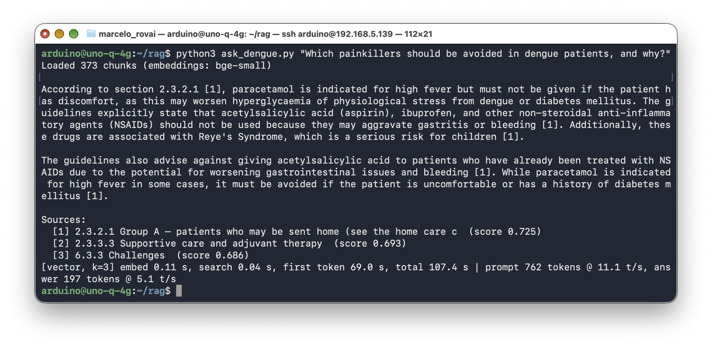

The script prints the answer, the sources it was built from, and a timing line:

```
According to section 2.3.2.1, ...

Sources:
  [1] 2.3.2.1 Group A – patients who may be sent home (see the home care c  (score 0.725)
  [2] 2.3.3.3 Supportive care and adjuvant therapy  (score 0.693)
  [3] 6.3.3 Challenges  (score 0.686)
[vector, k=3] embed 0.11 s, search 0.04 s, first token 69.0 s, total 107.4 s | prompt 762
tokens @ 11.1 t/s, answer 197 tokens @ 5.1 t/s
```

Read this answer carefully, because it is both a success and a failure.

The **retrieval succeeded**. Section 2.3.2.1, the home-care instructions for Group A patients, is the right passage, and it came first. The core of the answer is correct and correctly cited: do not give aspirin, ibuprofen, or other NSAIDs, because they may aggravate gastritis or bleeding, and aspirin may be associated with Reye's syndrome.

The **reading failed**, in three ways:

- **It inverted the paracetamol rule.** The guidelines say "Give paracetamol for high fever if the patient is uncomfortable." The model wrote that paracetamol "must not be given if the patient has discomfort", the opposite.
- **It moved a warning to the wrong sentence.** The passage cautions that *fluids containing sugar or glucose* may worsen hyperglycemia in patients with diabetes. The model attached that caution to paracetamol.
- **It invented a rule.** Nothing in the guidelines says to avoid aspirin in patients already treated with NSAIDs. The closest text, in source [2], tells patients already taking these drugs to consult their doctor.

Nothing in the pipeline can catch these errors: the source is right, the citation is right, and the sentences are wrong. 

> **Section 13 asks the same question of the 2B model, which reads the paracetamol rule correctly**.

This is why the script prints the sources. In a domain like this, a RAG answer is a pointer to the passage a human should read, not a replacement for it.

Notice also the timing line. Retrieval took 0.15 s (0.11 s to embed the question, 0.04 s to search). The first answer token arrived after 69.0 s: the model had to read 762 prompt tokens at 11.1 tokens/s, and almost all of them were the three retrieved chunks. Writing the 197-token answer took another 38 s at 5.1 tokens/s, for 107.4 s in total. Run the same question a second time, and it gets faster because the server reuses the part of the prompt it has already processed (in a repeated run, the server processed 467 new tokens and the first token arrived after 43.7 s); Section 12.1 explains how.

## 11. Measuring Retrieval Quality

Answers can be wrong for two different reasons: the right passage was never retrieved, or it was retrieved and the model misread it. Mixing the two makes tuning guesswork. Retrieval can be measured on its own, without the SLM, with a handful of questions whose answer location you know.

`~/rag/eval_retrieval.py` holds 17 questions labeled with the WHO section that answers them, two of them in Portuguese, plus four out-of-scope questions. It reports **hit@k**, the fraction of questions whose section appears among the top k results, and **MRR** (mean reciprocal rank: 1.0 if the right section is always first, 0.5 if always second):

```python
#!/usr/bin/env python3
"""
Measure retrieval quality with a small hand-labeled question set.

  python3 eval_retrieval.py --db dengue.db --mode vector
  python3 eval_retrieval.py --db dengue.db --mode hybrid --rerank

For each question we know which section of the WHO guidelines holds the
answer. hit@k = fraction of questions whose section appears in the top k.
The out-of-scope questions show where a similarity threshold should go.
No SLM is involved: only the embedding server (and the reranker) must run.
"""
import argparse
import time

from ask_dengue import Index, retrieve

QUESTIONS = [
    ("How long is the extrinsic incubation period of the virus in the mosquito?", ["1.4.4"]),
    ("How long does clinically significant plasma leakage last in the critical phase?", ["2.1.2"]),
    ("Which active ingredients should mosquito repellents contain?", ["3.2.6"]),
    ("How is the Breteau index calculated?", ["5.2.2.2"]),
    ("When are ovitraps better than larval surveys?", ["5.2.2.9"]),
    ("What should be done with discarded tires?", ["3.2.1.3"]),
    ("Which patients should be referred for in-hospital management?", ["2.3.2.2"]),
    ("How should specimens for virus isolation be kept before transport?", ["4.3.1"]),
    ("How many dengue virus serotypes are there, and what genus are they?", ["1.4.1"]),
    ("Can copepods be used to control Aedes aegypti?", ["3.2.7.2"]),
    ("What is the incubation period of dengue in humans?", ["1.4.2"]),
    ("What is a lethal ovitrap?", ["3.2.8.2"]),
    ("Which painkillers should be avoided in dengue patients?", ["2.3.2.1", "2.3.3.3"]),
    ("How many DALYs were lost to dengue globally in 2001?", ["1.2"]),
    # The case definitions in 1.1.6 and Textbox 2.3.3.3 also answer this one.
    ("Does a positive tourniquet test help diagnose dengue?", ["2.1.1", "1.1.6", "2.3.3.3"]),
    # Portuguese: does an English-only embedding model still find the passage?
    ("Quanto tempo dura o extravasamento de plasma na fase crítica?", ["2.1.2"]),
    ("Quais repelentes devem ser usados contra o mosquito?", ["3.2.6"]),
]

OUT_OF_SCOPE = [
    "How do I configure Wi-Fi on the Arduino UNO Q?",
    "What is the capital of France?",
    "How is malaria treated?",
    "Give me a recipe for sourdough bread.",
]


def main():
    ap = argparse.ArgumentParser()
    ap.add_argument("--db", default="dengue.db")
    ap.add_argument("--mode", choices=["vector", "hybrid"], default="vector")
    ap.add_argument("--rerank", action="store_true")
    ap.add_argument("--verbose", action="store_true")
    args = ap.parse_args()

    index = Index(args.db)
    hits = {1: 0, 3: 0, 5: 0}
    mrr, in_scope_best, t_total = 0.0, [], 0.0
    for q, expected in QUESTIONS:
        t0 = time.perf_counter()
        results, best, _ = retrieve(q, index, k=5, mode=args.mode,
                                    use_rerank=args.rerank)
        t_total += time.perf_counter() - t0
        in_scope_best.append(best)
        sections = [index.by_id[cid][1] for _, cid in results]
        rank = next((i for i, s in enumerate(sections, 1) if s in expected), None)
        for k in hits:
            hits[k] += rank is not None and rank <= k
        mrr += 1 / rank if rank else 0
        if args.verbose:
            print(f"{'ok ' if rank == 1 else rank or '-':>3} {best:.2f}  {q[:60]}  {sections}")

    n = len(QUESTIONS)
    print(f"{index.model:15s} {args.mode:6s} rerank={args.rerank!s:5s} "
          f"hit@1 {hits[1]}/{n}  hit@3 {hits[3]}/{n}  hit@5 {hits[5]}/{n}  "
          f"MRR {mrr / n:.2f}  ({t_total / n * 1000:.0f} ms/query)")

    out_best = [retrieve(q, index, k=1)[1] for q in OUT_OF_SCOPE]
    print(f"  best cosine, in scope: min {min(in_scope_best):.2f} "
          f"median {sorted(in_scope_best)[n // 2]:.2f} | "
          f"out of scope: {', '.join(f'{b:.2f}' for b in out_best)}")


if __name__ == "__main__":
    main()
```

```bash
python3 eval_retrieval.py --verbose
```

Results with `bge-small-en-v1.5` and the default 180-word chunks, plus the variants measured in Section 12:

| Retrieval | Chunks | hit@1 | hit@3 | hit@5 | MRR | Time per query |
|---|---|---|---|---|---|---|
| Vector | 180 words (373) | 13/17 | 14/17 | 16/17 | 0.82 | 0.14 s |
| Hybrid (vector + BM25) | 180 words | 12/17 | 15/17 | **17/17** | 0.81 | 0.15 s |
| Vector + rerank | 180 words | 14/17 | 15/17 | 15/17 | 0.85 | 9.2 s |
| Vector | 100 words (636) | 14/17 | 15/17 | **17/17** | 0.87 | 0.17 s |
| Hybrid | 100 words | 14/17 | **16/17** | 16/17 | **0.88** | 0.18 s |
| Vector, `all-MiniLM-L6-v2` | 180 words | 12/17 | 13/17 | 13/17 | 0.73 | 0.08 s |
| Hybrid, `all-MiniLM-L6-v2` | 180 words | 12/17 | 14/17 | 16/17 | 0.78 | 0.09 s |
| Vector, `embeddinggemma-300M` | 180 words | **15/17** | 16/17 | 16/17 | **0.91** | 0.44 s |
| Hybrid, `embeddinggemma-300M` | 180 words | 13/17 | 16/17 | **17/17** | 0.86 | 0.44 s |

Three things to take from this table:

- **Retrieval is good, and it is not the weak link.** With plain vector search, the right section is the first result for 13 of 17 questions and in the top 5 for 16. Two of the four questions that miss first place are the Portuguese ones, and the only question missing from the top 5 is Portuguese: `bge-small-en-v1.5` is an English model.
- **Labeling is a judgment call.** The first version of the evaluation expected only section 2.1.1 for "Does a positive tourniquet test help diagnose dengue?", and counted the retriever wrong. But section 1.1.6, the case classification, lists "tourniquet test positive" among the criteria for probable dengue, which is a valid answer. The label now accepts three sections. When an evaluation says your system is wrong, read what it retrieved before believing it.
- **A bigger embedding model helps, at an indexing cost.** EmbeddingGemma-300M put the right section first for 15 of 17 questions, including both Portuguese ones, but took 26 minutes to build the index (Section 16 has the details).
- **The faster embedding model is noticeably weaker.** MiniLM builds the index in half the time (176 s), but alone it misses 4 of 17 questions even in the top 5. Hybrid search closes most of that gap, which makes MiniLM plus BM25 a reasonable choice when indexing time matters.
- **Measure before you tune.** Every improvement in Section 12 is judged against this table.

> **The index and the server must use the same embedding model.** While running these evaluations, a MiniLM index was once queried through a server that was running BGE. Nothing crashed: the vectors had the same 384 dimensions, the dot products were computed, and hit@5 dropped from 13 to 9 out of 17. A model mismatch looks exactly like a bad model. That is why `build_index.py` stores a *probe* vector (the embedding of one fixed sentence) in the index, and `ask_dengue.py` re-embeds the same sentence at startup and refuses to run if the two differ.

## 12. Advanced Techniques, Measured

### 12.1 Chunk Size and Top-k Against Latency

Section 7 found that each prompt token costs about 0.09 s of prefill. The prompt is mostly retrieved chunks, so the size and number of chunks set the latency. `~/rag/rag_bench.py` asks three questions with different values of k and reports the averages:

```bash
python3 rag_bench.py --db dengue.db --k 1 2 3 5 --cold
```

Measured with `--cold`, which disables llama-server's prompt cache so that every prompt is processed in full. These are the numbers for a new question:

| k | Chunk size | Prompt tokens | First token | Total |
|---|---|---|---|---|
| 1 | 180 words | 362 | 31.9 s | 43.4 s |
| 2 | 180 words | 660 | 59.6 s | 70.5 s |
| 3 | 180 words | 905 | 83.1 s | 95.1 s |
| 5 | 180 words | 1,334 | 126.6 s | 138.0 s |
| 3 | 100 words | 557 | 49.8 s | 57.3 s |
| 5 | 100 words | 893 | 81.8 s | 87.5 s |

The relation is close to linear: each 180-word chunk adds about 270 tokens and about 25 s before the first word of the answer. Generation adds roughly 10 s more for a 60-word answer, whatever k is.

Put this table next to the retrieval table in Section 11 and the trade-off becomes a choice you can make with evidence:

- **100-word chunks with k=3** found the right section in the top 3 for 15 or 16 of 17 questions (vector or hybrid), with a first token at **50 s**.
- **180-word chunks with k=3** found it for 14 or 15, with a first token at **83 s**.

Smaller chunks were both more precise *and* faster here. They have a cost the retrieval numbers don't show: a 100-word passage carries less surrounding context, and an answer that needs two consecutive paragraphs may get only one. To use them, rebuild the index:

```bash
python3 build_index.py docs/who_dengue_2009.txt --db dengue_100.db --max-words 100 --overlap 15
python3 ask_dengue.py --db dengue_100.db --mode hybrid "..."
```

The index has 636 chunks instead of 373, and still took about 6 minutes to build (358 s), since the total amount of text is nearly the same.

### Prompt Caching: Why the Second Question Can Be Faster

Run `rag_bench.py` *without* `--cold` and some rows get much cheaper. In one run, k=2 processed only 146 of its 660 prompt tokens, and the first token came after 13.7 s instead of 59.6 s. `llama-server` keeps the processed prompt (its KV cache) of each slot, and when a new request starts with the same tokens, it skips them. The k=2 prompt for a question begins with exactly the k=1 prompt for that question, which was still cached.

Two practical consequences for a RAG prompt:

- **Put what is stable first.** The system prompt comes first and is processed once for the whole session. The retrieved chunks come next and the question last, so a follow-up question that retrieves the same passages reuses all of them.
- **Benchmark cold.** Cached runs make a system look faster than it will be for a new user. `cache_prompt: false` in the request (the `--cold` flag) gives honest numbers.

### 12.2 Hybrid Search: Keywords and Meaning

Embeddings match meaning, which is why "water-filled containers" finds "standing water". They are weaker on exact terms: an index name, a drug name, a number. Classic keyword search (BM25, the algorithm behind most search engines until recently) has the opposite strengths. **Hybrid search** runs both and merges the results.

SQLite's FTS5 extension provides BM25 ranking out of the box; `build_index.py` already filled the `chunks_fts` table. Merging two ranked lists whose scores are not comparable (cosine similarity against BM25) is done with **Reciprocal Rank Fusion**: each chunk scores `1 / (60 + rank)` in each list, and the scores are added. A chunk ranked high by either method rises; one ranked high by both rises most. It is twelve lines in `ask_dengue.py` (`keyword_search()` and `rrf()`).

```bash
python3 eval_retrieval.py --mode hybrid --verbose
python3 ask_dengue.py --mode hybrid "How is the Breteau index calculated?"
```

On the evaluation set, hybrid search found the right section in the top 5 for all 17 questions, against 16 for vectors alone, and it rescued one of the two Portuguese questions, about how long plasma leakage lasts: the English-only embedding model ranked the right section fifth, but *plasma* is spelled the same in both languages, and that one shared keyword was enough for BM25 to lift section 2.1.2 to first place. It also lost one first place: "What should be done with discarded **tires**?" is found by the embeddings (the model knows *tires* and *tyres* are the same thing), but BM25 matches only the exact British spelling *tyres* the WHO uses, and its vote pushed another chunk ahead. Neither method dominates, which is the case for combining them.

The same hybrid search, when asked the painkiller question from Section 10, retrieved the right sections (2.3.3.3 and 2.3.2.1), but the model still replied, "The guidelines do not cover this." Keyword matching on *should*, *avoided*, and *patients* had pulled in a passage about saline and Ringer's lactate, and the prompt grew to 965 tokens. With `temperature` 0 the model refused every time; at the script's 0.3 it refused in two of four runs. A better retrieval score does not guarantee a better answer: for a 0.8B model, an irrelevant passage and a longer prompt make the "I don't know" exit more attractive. Judge a retrieval change by the answers it produces, not only by hit@k. The cheap fixes did not rescue the 0.8B: with `--k 2` it said the guidelines do not list the drugs, and with `--rerank` it pinned the diabetes caution on aspirin. Given the identical 965-token prompt, the 2B model (Section 13) answered correctly at `temperature` 0, with every rule in its right place, but took 257 s instead of 90 s.

The Breteau question shows a different limit, one no retrieval method can fix:

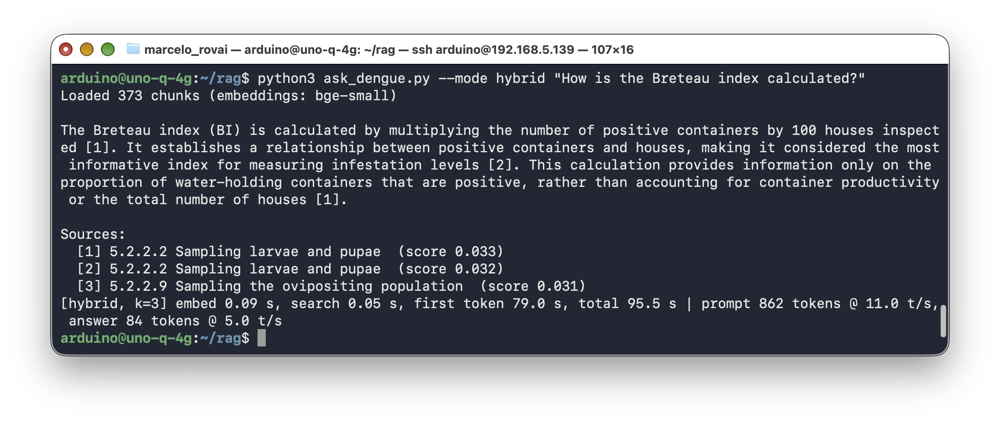

```
The Breteau index (BI) is calculated by multiplying the number of positive containers
by 100 houses inspected [1]. [...]

Sources:
  [1] 5.2.2.2 Sampling larvae and pupae  (score 0.033)
  [2] 5.2.2.2 Sampling larvae and pupae  (score 0.032)
  [3] 5.2.2.9 Sampling the ovipositing population  (score 0.031)
[hybrid, k=3] embed 0.09 s, search 0.05 s, first token 79.0 s, total 95.5 s | prompt 862 tokens @ 11.0 t/s, answer 84 tokens @ 5.0 t/s
```

(Hybrid scores are RRF scores, not cosines, hence the small numbers.) The right section was retrieved twice, and the answer is still garbled. The PDF prints the index as a fraction, *positive containers × 100* over *houses inspected*, and `pdftotext` flattened it into one line: `BI = Number of positive containers X 100 houses inspected`. The fraction bar is gone, and the model faithfully repeats the broken text. **Formulas, tables, and figures are where PDF extraction loses the most**; for a knowledge base you depend on, check the chunks that hold them, and fix them by hand if needed.

### 12.3 Saying "I Don't Know"

A RAG system always retrieves *something*, even for a question the documents do not cover. The model may then answer from irrelevant passages, or from its own memory. Two defenses:

1. **The prompt**: the system prompt tells the model to reply "The guidelines do not cover this" when no passage answers. This costs nothing extra, but depends on a small model obeying.
2. **A similarity threshold**: if even the best chunk is far from the question, skip the SLM entirely and answer "not covered" in 0.2 s instead of a minute.

The evaluation in Section 11 printed the best cosine score for in-scope and out-of-scope questions:

| Question set | Best cosine with bge-small |
|---|---|
| 17 in-scope questions | 0.60 to 0.84 (median 0.78) |
| "Give me a recipe for sourdough bread." | 0.45 |
| "What is the capital of France?" | 0.46 |
| "How do I configure Wi-Fi on the Arduino UNO Q?" | 0.47 |
| "How is malaria treated?" | **0.66** |

A threshold of 0.55 separates the clearly unrelated questions from every in-scope one:

```bash
python3 ask_dengue.py --threshold 0.55 "Give me a recipe for sourdough bread."
```

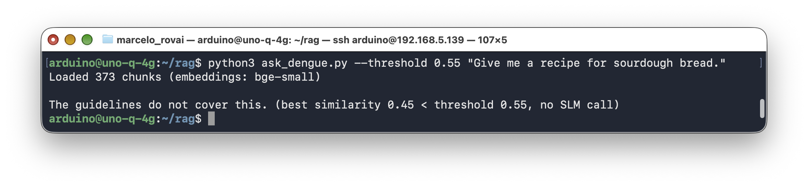

That answer took a fraction of a second. But no threshold catches "How is malaria treated?": it is a medical question about a mosquito-borne disease, and it scores higher than both Portuguese questions that the guidelines *do* answer. (The multilingual EmbeddingGemma model does separate it, at a cost; see Section 16.) With BGE, the prompt is the defense, and the 0.8B handled it well:

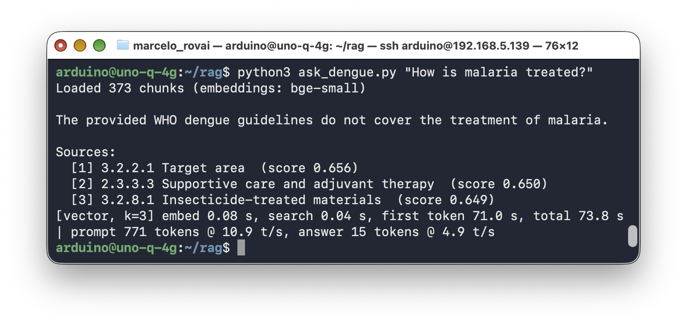

Correct, but it cost 74 seconds to say no. Use a threshold as a cheap first filter for obviously unrelated questions, set based on your own evaluation data, and keep the prompt instruction for near misses.

### 12.3.1 What the Knowledge Base Does Not Know

A related failure is one no threshold or prompt can catch: the document is out of date.

```bash
python3 ask_dengue.py --mode hybrid "Is there a vaccine against dengue?"
```

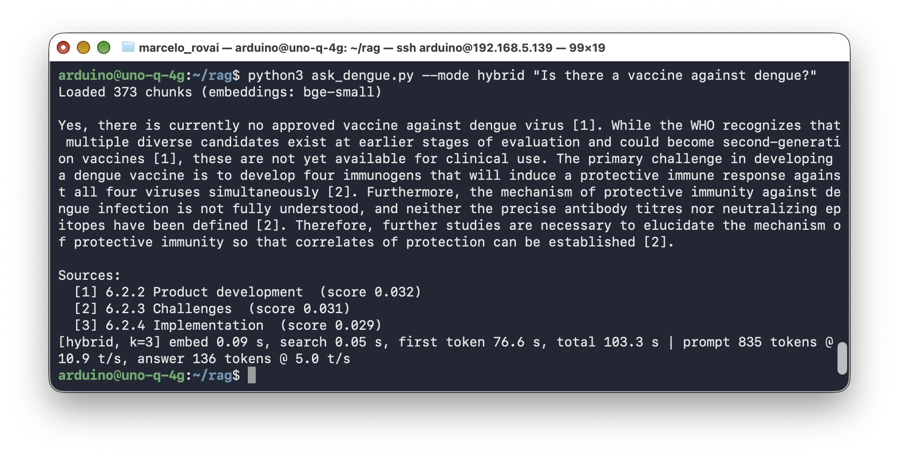

For 2009, that is a faithful summary of section 6.2. It is not true today: dengue vaccines have been licensed since, and some countries, Brazil among them, include one in their public vaccination programs. RAG made the model *faithful to the documents*, which is exactly what it was asked to do. Keeping the documents current is part of the system.

### 12.4 Reranking

Embedding search compares the question and each chunk *separately*: each is turned into a vector without seeing the other. A **reranker** (a *cross-encoder*) reads the question and a candidate chunk *together* and scores how well the chunk answers it. It is more accurate, and much slower, so it is used in two stages: retrieve a broad pool cheaply (here, 12 chunks), then rerank only those and keep the best k.

`llama-server` serves rerankers with `--reranking` and an OpenAI-style `/v1/rerank` endpoint. A tiny English reranker fits the budget:

```bash
cd ~/models/embed
wget -c https://huggingface.co/gpustack/jina-reranker-v1-tiny-en-GGUF/resolve/main/\
jina-reranker-v1-tiny-en-Q8_0.gguf

~/llama.cpp/build/bin/llama-server \
  --model ~/models/embed/jina-reranker-v1-tiny-en-Q8_0.gguf \
  --reranking --port 8083 --threads 4 \
  --ctx-size 4096 --batch-size 2048 --ubatch-size 2048 &
```

Then add `--rerank` to `eval_retrieval.py` or `ask_dengue.py` (the `rerank()` function in `ask_dengue.py` sends the pool to port 8083):

```bash
python3 eval_retrieval.py --rerank --verbose
```

| Retrieval (180-word chunks) | hit@1 | hit@3 | hit@5 | Time per query |
|---|---|---|---|---|
| Vector | 13/17 | 14/17 | 16/17 | 0.14 s |
| Vector + rerank (pool of 20) | 14/17 | 15/17 | 15/17 | 9.2 s |
| Hybrid + rerank (pool of 20) | 14/17 | 15/17 | 15/17 | 8.9 s |

The evaluation asks for the top 5, so its pool is 20 chunks. The reranker moved one right answer into first place and pushed two out of the top 5: the tourniquet question and the Portuguese plasma question. Scoring 20 question–chunk pairs took about 9 seconds, the price of about 100 extra prompt tokens in the SLM; with the default k=3 of `ask_dengue.py`, the pool is 12 and reranking takes 5 to 7 seconds. The reranker server used 77 MB of RAM.

The answer it moved into first place shows what a reranker is for:

```bash
python3 ask_dengue.py "Quais repelentes devem ser usados contra o mosquito?"
python3 ask_dengue.py --rerank "Quais repelentes devem ser usados contra o mosquito?"
```

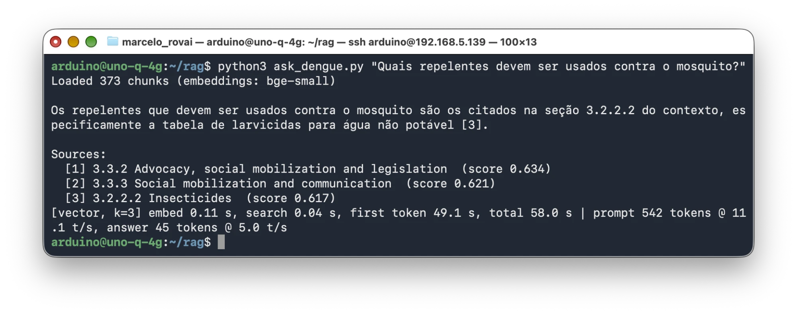

Without reranking, the top 3 were sections 3.3.2 (advocacy and legislation), 3.3.3 (social mobilization), and 3.2.2.2 (insecticides). Section 3.2.6, *Individual and household protection*, which lists the repellents, was sixth, just outside the prompt. The model did what it could with the wrong passages and pointed, in Portuguese, to a table of larvicides for non-potable water: cited, and wrong.

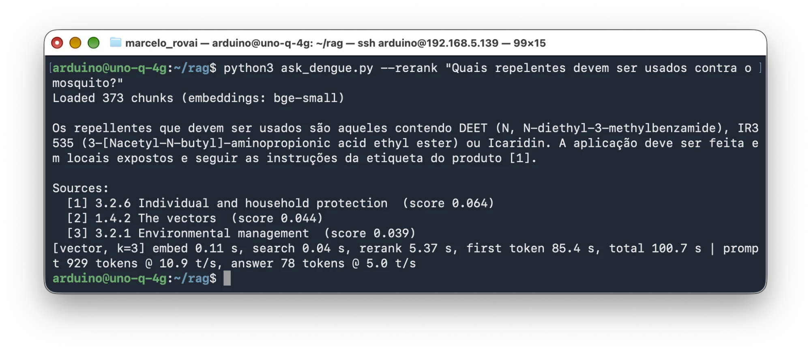

With `--rerank`, the reranker read the question together with each of the 12 candidates and moved section 3.2.6 to first place. The answer is now correct and grounded: repellents containing DEET, IR3535, or Icaridin, applied to exposed skin and used according to the label instructions, which is what the guidelines say. The vector search already had the right passage in its pool; it had ranked it sixth. That is the case a reranker fixes. The fix is not free: reranking took 5.4 s, and the answer took 100.7 s instead of 58.0 s, mostly because the new prompt was longer (929 tokens against 542). The reranker is English-only; the Portuguese question probably works because *repelentes* and *mosquito* are close to their English forms.

On this document and this question set, reranking isn't worth it: hybrid search already reaches 17/17 in the top 5 for almost nothing. A reranker earns its cost when the first stage is noisier, as with a larger collection or a weaker embedding model. Measure before you add it.

The painkiller question shows the cost of a wrong reranking. The reranker dropped section 2.3.2.1, the passage with the answer, and kept a 2.3.3.3 chunk about colloid solutions; the 0.8B model then answered that the guidelines do not list the drugs. The evaluation still counts this as a hit, because its label accepts section 2.3.3.3: a section-level label cannot tell the right chunk from the wrong chunk in the same section.

## 13. Agentic RAG: Letting the Model Decide When to Search

The pipeline so far retrieves for every question, including "What is the capital of Brazil?". The Raspberry Pi version of this chapter routed questions with keyword rules and a classification prompt. [Agentic AI at the Edge](../5-Agentic_AI/README.md) showed a cleaner way: give the model **tools** through llama-server's native tool-calling API, and let it decide. Retrieval becomes one tool among others.

`~/rag/agentic_rag.py` offers two tools: `search_guidelines` (the hybrid retrieval from Section 12.2, top 2 chunks) and `calculate` (the AST-based calculator from the agentic chapter).


<!-- Diagram source: images/png/agentic-rag.mmd (Mermaid; render with Quarto mermaid-format: png). -->

The full script:

```python
#!/usr/bin/env python3
"""
Agentic RAG: the SLM decides whether to search the WHO guidelines,
use a calculator, both, or neither, through llama-server's native
tool-calling API (start llama-server with --jinja).

  python3 agentic_rag.py "A survey found 37 positive containers in 250 houses. What is the Breteau index?"
  python3 agentic_rag.py --force-tool "..."     # first reply must be a tool call
"""
import ast
import json
import operator
import sys
import time

import requests

from ask_dengue import Index, retrieve

CHAT_URL = "http://127.0.0.1:8081/v1/chat/completions"
MODEL = "qwen3.5-0.8b"
MAX_TURNS = 4

index = Index("dengue.db")

TOOLS = [
    {"type": "function", "function": {
        "name": "search_guidelines",
        "description": "Search the WHO dengue guidelines (diagnosis, treatment, "
                       "mosquito control, surveillance indices). Returns relevant passages.",
        "parameters": {"type": "object", "properties": {
            "query": {"type": "string", "description": "What to look for"}},
            "required": ["query"]}}},
    {"type": "function", "function": {
        "name": "calculate",
        "description": "Evaluate an arithmetic expression, e.g. '37 * 100 / 250'.",
        "parameters": {"type": "object", "properties": {
            "expression": {"type": "string"}},
            "required": ["expression"]}}},
]

SYSTEM = ("You are a dengue assistant. Use search_guidelines for anything about "
          "dengue or mosquitoes, and calculate for any arithmetic. Answer general "
          "questions directly. Keep answers short.")


# ─── The tools ──────────────────────────────────────────────────────
def search_guidelines(query):
    hits, _, _ = retrieve(query, index, k=2, mode="hybrid")
    return "\n\n".join(f"(section {index.by_id[cid][1]}) {index.by_id[cid][3]}"
                       for _, cid in hits)


OPS = {ast.Add: operator.add, ast.Sub: operator.sub, ast.Mult: operator.mul,
       ast.Div: operator.truediv, ast.Pow: operator.pow, ast.USub: operator.neg}


def calculate(expression):
    """Arithmetic only: walk the syntax tree instead of calling eval()."""
    def ev(node):
        if isinstance(node, ast.Constant) and isinstance(node.value, (int, float)):
            return node.value
        if isinstance(node, ast.BinOp) and type(node.op) in OPS:
            return OPS[type(node.op)](ev(node.left), ev(node.right))
        if isinstance(node, ast.UnaryOp) and type(node.op) in OPS:
            return OPS[type(node.op)](ev(node.operand))
        raise ValueError("unsupported expression")
    try:
        return str(round(ev(ast.parse(expression, mode="eval").body), 4))
    except Exception as e:
        return f"error: {e}"


DISPATCH = {"search_guidelines": search_guidelines, "calculate": calculate}


# ─── The agent loop ─────────────────────────────────────────────────
def run(question, force_tool=False):
    messages = [{"role": "system", "content": SYSTEM},
                {"role": "user", "content": question}]
    t_start = time.perf_counter()
    for turn in range(MAX_TURNS):
        # "required" makes the first reply a tool call; later turns choose freely.
        choice = "required" if force_tool and turn == 0 else "auto"
        r = requests.post(CHAT_URL, json={
            "model": MODEL, "messages": messages, "tools": TOOLS,
            "tool_choice": choice,
            "max_tokens": 200, "temperature": 0.3, "top_p": 0.8,
            "presence_penalty": 1.5}, timeout=900)
        r.raise_for_status()
        data = r.json()
        msg, tm = data["choices"][0]["message"], data["timings"]
        print(f"  [turn {turn}] prompt {tm['prompt_n']} new tokens, "
              f"{tm['predicted_n']} generated, {(tm['prompt_ms'] + tm['predicted_ms']) / 1000:.1f} s")
        calls = msg.get("tool_calls") or []
        if not calls:
            print(f"\n{msg.get('content', '').strip()}")
            break
        messages.append(msg)
        for call in calls:
            name = call["function"]["name"]
            args = json.loads(call["function"]["arguments"] or "{}")
            result = DISPATCH[name](**args) if name in DISPATCH else "unknown tool"
            print(f"  [turn {turn}] tool call: {name}({args}) -> {result[:80]!r}")
            messages.append({"role": "tool", "tool_call_id": call["id"],
                             "content": result})
    print(f"\nTotal: {time.perf_counter() - t_start:.1f} s")


if __name__ == "__main__":
    args = sys.argv[1:]
    force = bool(args) and args[0] == "--force-tool"
    question = " ".join(args[1:] if force else args)
    if question:
        run(question, force_tool=force)
    else:
        try:
            while True:
                q = input("\n> ").strip()
                if q:
                    run(q, force_tool=force)
        except (KeyboardInterrupt, EOFError):
            print("\nBye!")
```

The test question needs both tools in sequence: the formula is in the guidelines, and the arithmetic should not be left to a 0.8B model.

```bash
python3 agentic_rag.py "A survey found 37 positive containers in 250 houses. What is the Breteau index?"
```

With Qwen3.5-0.8B:

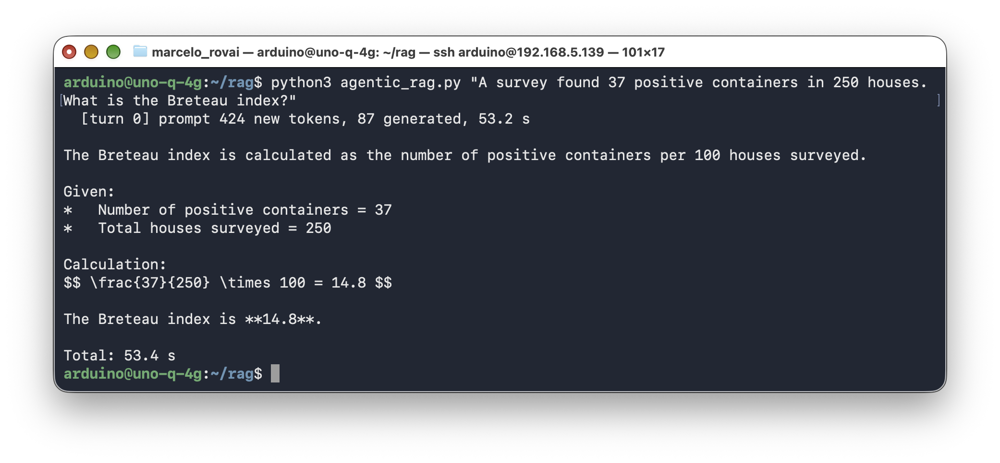

The model called **no tool at all**: it neither searched the guidelines nor used the calculator, and answered from memory. In this run the memory was right, 14.8; in an earlier run of the same command it answered 0.148, missing the factor of 100. Without a tool call, a correct result is luck, not design.

The other two test questions went better. "What is the capital of Brazil?" got a direct answer in 3.2 s with no retrieval, which is exactly the saving the router was supposed to bring. "Which painkillers should be avoided?" was also answered from memory (18 s, correct on aspirin and NSAIDs, but uncited). This matches what [Agentic AI at the Edge](../5-Agentic_AI/README.md) found: at 0.8B, the decision to use a tool is the weak link.

Can the model be *made* to use a tool? The OpenAI API has `tool_choice: "required"`, which `agentic_rag.py --force-tool` sends on the first turn. On the UNO Q with Qwen3.5-0.8B it did not help: the reply was again plain text, the wrong 0.148 again, now 200 tokens long and with a stray `</think>` tag in the middle. The setting was not enforced for this model. If you need the search to happen, do it in code: retrieve first, as `ask_dengue.py` does, and let the model only read.

Now restart port 8081 with the 2B model (same alias, so no Python changes; see the [agentic chapter](../5-Agentic_AI/README.md)) and ask again:

```bash
pkill -f "[a]lias qwen3.5-0.8b"
nohup ~/llama.cpp/build/bin/llama-server --model ~/models/Qwen3.5-2B-UD-Q4_K_XL.gguf \
  --port 8081 --host 0.0.0.0 --jinja --reasoning off --reasoning-budget 0 \
  --ctx-size 4096 --threads 4 --batch-size 512 --ubatch-size 64 \
  --predict 1024 --alias qwen3.5-0.8b > ~/rag/logs/slm2b.log 2>&1 &
```

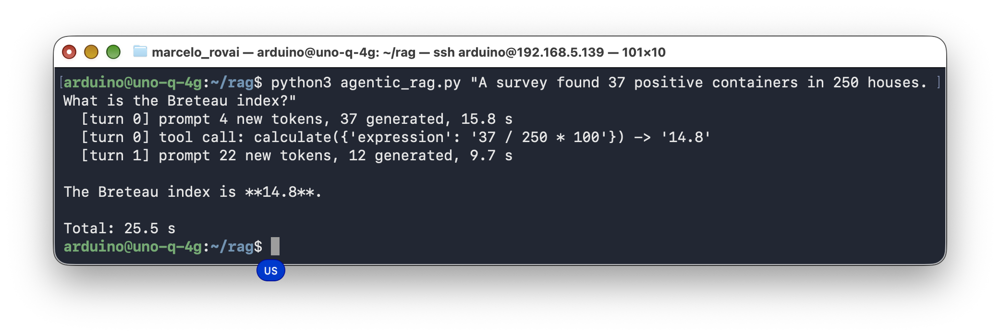

Correct. The 2B knew the formula well enough not to search for it, and delegated the arithmetic. This screenshot is a second run, with the prompt already in the server's cache (4 new tokens, 25.5 s in total). The first, cold run read all 424 prompt tokens in 107.1 s and took 116.9 s, the numbers in the diagram above. It also fixed both reading failures from earlier sections, using the same retrieved passages:

| Question (same chunks, k=3) | Qwen3.5-0.8B Q8_0 | Qwen3.5-2B UD-Q4_K_XL |
|---|---|---|
| Painkillers | Inverted the paracetamol rule | Correct: paracetamol "if the patient is uncomfortable", at intervals of at least six hours |
| Breteau index | Repeated the garbled formula | Reconstructed it: "multiplying the number of positive containers by 100 and dividing by the total number of houses inspected" |
| Time to first token | 44–53 s | 170–192 s |
| Total time | 63–70 s | 212–216 s |

The 2B reads better and costs about 3.5× the time per answer, because its prefill runs at 4.5 tokens per second against 11. For a question someone asks once and acts on, that may be worth it; for an interactive demo, it is not.

### A Third Candidate: LFM3-1.7B

Liquid AI released LFM3-1.7B on October 27, 2026, aimed at on-device use and with official support for 16 languages, Portuguese among them. A model between our two sizes, from a different architecture family, is a natural test: does it read like the 2B, but closer to the speed of the 0.8B? The official GGUF runs on the same llama.cpp build. Download the Q4_K_M file (1.1 GB) and restart port 8081 with it, as we did for the 2B:

```bash
cd ~/models
wget -c https://huggingface.co/LiquidAI/LFM3-1.7B-GGUF/resolve/main/LFM3-1.7B-Q4_K_M.gguf

pkill -f "[a]lias qwen3.5-0.8b"
nohup ~/llama.cpp/build/bin/llama-server --model ~/models/LFM3-1.7B-Q4_K_M.gguf \
  --port 8081 --host 0.0.0.0 --jinja --reasoning off --reasoning-budget 0 \
  --ctx-size 4096 --threads 4 --batch-size 512 --ubatch-size 64 \
  --predict 1024 --alias qwen3.5-0.8b > ~/rag/logs/lfm3.log 2>&1 &
```

Reasoning is on by default in LFM3, so `--reasoning off` matters here: without it, the 200-token answer budget would be spent thinking. We kept the Qwen alias, so no script changes. With `llama-bench`, LFM3 reads prompts at 4.9 to 5.0 tokens per second and writes at 3.3: in prefill, the step that dominates RAG on this board, it is no faster than the 2B. We gave it the same prompts as the two Qwen models, at `temperature` 0 and with a cold cache:

| Test (same chunks) | LFM3-1.7B Q4_K_M | Time to first token / total |
|---|---|---|
| Painkillers, vector, k=3 | Correct on aspirin and NSAIDs, with the reasons; does not mention paracetamol; adds "The guidelines do not cover this" twice, next to the right answer | 150 s / 215 s |
| Painkillers, hybrid, k=3 (the 965-token prompt the 0.8B refused) | Correct, including paracetamol "for high fever if the patient is uncomfortable" | 192 s / 243 s |
| Breteau index, hybrid, k=3 | Works out "times 100 divided by total houses inspected" while correcting itself aloud ("Wait—actually..."), and runs out of the 200-token budget before a clean answer | 173 s / 243 s |
| Plasma leakage, asked in Portuguese | Correct, 24 to 48 hours, with the citation, but answered in English | 162 s / 188 s |
| Agentic: Breteau index from 37 and 250 | Correct, 14.8, with the formula | 381 s total |
| Agentic: capital of Brazil | Brasília, noting that no tool was needed | 45.5 s total |

Every answer started with a stray `</think>` tag, even with reasoning turned off; strip it in code if you display the answers. In the agentic run, the server received three requests for the Breteau question, so the model went back to the tools at least once; the tool calls themselves were not captured in this run.

LFM3 fixed the failure that defeated the 0.8B on the hybrid prompt, and it reads closer to the 2B than to the 0.8B. But on this CPU it costs the same time as the 2B, and its answers need more cleaning. For this chapter, it does not change the trade-off: Qwen3.5-0.8B when speed matters, a 2B-class model when the reading matters.

## 14. Performance: What to Actually Expect

Measured on a UNO Q 4 GB, llama.cpp commit `5220213`, 4 threads, no heatsink or fan, Qwen3.5-0.8B Q8_0 with `--ctx-size 4096`, and `bge-small-en-v1.5` Q8_0:

| Metric | Value |
|---|---|
| PDF to text (`pdftotext`, 160 pages) | 10 s |
| Index build, 373 chunks / 73,709 tokens | 353 s (209 tokens/s) |
| Index file size | 1.7 MB |
| RAM: embedding server (process RSS) | 76–97 MB |
| RAM: SLM server, 0.8B / 2B | ~1.0 GB / ~1.55 GB |
| RAM available with both servers running (0.8B) | ~2.8 GB |
| Query embedding | 0.08–0.13 s |
| Vector search, 373 chunks, pure Python | 0.04 s |
| Hybrid search (+ FTS5 BM25 and RRF) | +0.01 s |
| Reranking 12 / 20 candidates (`jina-reranker-v1-tiny-en`) | 5–7 s / ~9 s |
| Threshold rejection (no SLM call) | < 0.2 s |
| Prefill, 0.8B / 2B / LFM3-1.7B | ~11 / ~4.5 / ~4.9 tokens/s |
| Generation with a RAG prompt, 0.8B / 2B / LFM3-1.7B | ~5.0 / ~2.4 / ~2.9 tokens/s |
| First token, k=3, 180-word chunks, cold | 83 s |
| First token, k=3, 100-word chunks, cold | 50 s |
| Board temperature during the measurement runs | 60–61 °C |

Takeaways:

- **Retrieval is cheap; reading is expensive.** Everything before the SLM call takes about 0.15 s. The SLM's prefill takes 50 to 130 s for 3 to 5 chunks. Optimize the prompt size first.
- **Generation is a little slower with long prompts** (5.0 tokens/s here, against 5.6 for the short chat prompts of chapter 2), because each new token attends to a longer context.
- **The 2B costs about 2.5× per token** in both prefill and generation, and in exchange reads the passages correctly where the 0.8B did not (Section 13).
- **Thermals are not a concern**, as in the earlier chapters: about 60 °C in sustained use.

## 15. Tips, Tricks, and Troubleshooting

### `pkill -f` Kills Your Own SSH Session

A pattern like `pkill -f "alias bge-small"` sent over `ssh` also matches the `bash -c` process running that very command, which is killed with it (exit code 255). Use `pkill llama-server`, or the bracket trick `pkill -f "[a]lias bge-small"`, whose pattern does not match its own text.

### Embedding Requests Fail With "input is too large"

The chunk is longer than the server's micro-batch. Start the embedding server with `--ubatch-size` at least as large as the longest chunk in tokens (2048 in this chapter), or make the chunks smaller.

### All Similarity Scores Are Nearly the Same

The embedding model or its GGUF conversion is broken, or it is being used without the pooling it was trained with (see the sanity check in Section 5). Try another GGUF of the same model, or another model.

### The Model Answers, Then Adds "The guidelines do not cover this"

Small models sometimes attach the refusal sentence to a valid answer. The phrasing in `ask_dengue.py` ("Only if no passage answers the question, reply with just...") reduced it in testing; check for it in code if you act on the answer automatically.

### Answers Start With `</think>`

Some models (LFM3-1.7B in Section 13) emit the closing tag of their reasoning block even with `--reasoning off`. It is harmless; remove it before you display or parse the answer.

### Answers Ignore the Context

Check the retrieval first (`eval_retrieval.py`, or the "Sources" list): if the right passage is not there, no prompt will help. If it is there, try fewer, more relevant chunks, since a 0.8B model is easily distracted by long contexts, or switch to the 2B.

### Out-of-Memory

Both servers together use about 1.1 GB. If you add the reranker and then switch to the 2B model, check `free -m`; the 2B with a 4096-token context uses about 1.5 GB on its own.

## 16. Going Further

- **Your own documents.** `build_index.py` only needs a text file. For other PDFs, adapt the cleaning rules to their headers and section numbering; for Markdown or HTML sources, split on headings instead.
- **A web interface.** Wrap `ask()` in a Flask endpoint as in [GenAI Meets the Real World](../4-Gen_AI_Edge/README.md), so a phone on the same network can query the guidelines.
- **RAG for the dengue risk classifier.** Retrieve the WHO vector-control passages that match the sensor readings (temperature, humidity, standing water) and pass them to the classifier's prompt, so its explanation cites the guidelines.
- **Incremental indexing.** Store a hash of each source file in `meta`, and re-embed only the files that changed.
- **sqlite-vec.** For collections too large for brute-force search, the `sqlite-vec` extension adds vector indexes to the same SQLite file (it needs `pip`, which the current image lacks).
- **Better multilingual retrieval.** Google's `embeddinggemma-300M` (multilingual, 768 dimensions) was the best retriever measured for this chapter: vector search put the right section first for 15 of 17 questions (MRR 0.91), and it found both Portuguese questions in first place, where BGE found neither. It also separated the out-of-scope questions cleanly: "How is malaria treated?" scored 0.40, below every in-scope question (minimum 0.52), so a threshold near 0.45 rejects it without an SLM call. The price is indexing time: 1,568 s (26 minutes) for the whole document, against 6 minutes for BGE, and 0.44 s per query. Download it from <https://huggingface.co/ggml-org/embeddinggemma-300M-GGUF>, and use the `embeddinggemma` prefixes already in the scripts' `PREFIXES` table. For a classroom of Portuguese or Spanish speakers asking about English documents, the extra 20 minutes, spent once, are worth it.

## 17. Conclusion

### What We Covered

This chapter built retrieval-augmented generation on the Arduino UNO Q from first principles: an embedding model served by `llama-server`, cosine similarity as a dot product, a minimal RAG over a list of facts, and then a full application over a 160-page WHO guideline, with PDF cleaning, structure-aware chunking, a SQLite vector store, cited answers, and measured improvements: hybrid search, thresholds, reranking, and agentic retrieval.

### Advantages of RAG at the Edge

- **Knowledge without retraining.** The 0.8B model answered questions about a document it never saw in training; changing the knowledge means rebuilding a 1.7 MB index, not a model.
- **Cheap retrieval.** A 37 MB embedding model, about 100 MB of RAM, and 0.15 s per query.
- **Traceable answers.** Every answer lists the sections it came from.
- **Private and offline.** The documents, the questions, and the answers never leave the board.

### Limitations and Considerations

- **Prefill is the bottleneck.** At about 11 tokens per second, every retrieved chunk adds seconds to the wait. Retrieval quality and latency trade against each other, and Section 12.1 is where you choose.
- **A small model still misreads good context.** RAG fixes "didn't know", not "didn't understand". The 2B reads the same passages more reliably, at about 2.5× the cost.
- **The index is only as good as the cleaning.** PDFs need document-specific rules, and tables and figures are mostly lost.
- **The knowledge base ages.** The 2009 guidelines predate the dengue vaccines now in use. RAG answers what the documents say, which is not always what is true today.

### Where This Fits

Chapters 2 to 5 gave the small model a voice, eyes, a body, and tools. This one gives it a library. Together they are the pieces of most real edge GenAI applications: a model that reads the sensors, looks up what it does not know, and acts.

## 18. Resources

### Useful Resources

| Resource | URL |
|---|---|
| WHO, *Dengue: Guidelines for diagnosis, treatment, prevention and control* (2009) | <https://iris.who.int/handle/10665/44188> |
| llama-server docs (`/v1/embeddings`, `/v1/rerank`) | <https://github.com/ggml-org/llama.cpp/blob/master/tools/server/README.md> |
| bge-small-en-v1.5 GGUF (CompendiumLabs) | <https://huggingface.co/CompendiumLabs/bge-small-en-v1.5-gguf> |
| all-MiniLM-L6-v2 GGUF (second-state) | <https://huggingface.co/second-state/All-MiniLM-L6-v2-Embedding-GGUF> |
| jina-reranker-v1-tiny-en GGUF (gpustack) | <https://huggingface.co/gpustack/jina-reranker-v1-tiny-en-GGUF> |
| MTEB embedding leaderboard | <https://huggingface.co/spaces/mteb/leaderboard> |
| SQLite FTS5 | <https://www.sqlite.org/fts5.html> |
| *Edge AI Engineering* — SLM optimization techniques: RAG (Raspberry Pi version) | <https://mjrovai.github.io/EdgeML_Made_Ease_ebook/raspi/llm/slm_opt_tech.html#retrieval-augmented-generation-rag> |
| *Edge AI Engineering* — Advancing EdgeAI: RAG (Raspberry Pi version) | <https://mjrovai.github.io/EdgeML_Made_Ease_ebook/raspi/advancing_adgeai/adv_edgeai.html#retrieval-augmented-generation-rag> |
| Scripts for this chapter | <https://github.com/Mjrovai/ARDUINO-UNO-Q/tree/main/RAG_Edge> |

### References

1. World Health Organization, *Dengue: Guidelines for Diagnosis, Treatment, Prevention and Control*, new edition, Geneva, 2009.
2. Lewis, P. et al., "Retrieval-Augmented Generation for Knowledge-Intensive NLP Tasks," *NeurIPS*, 2020.
3. Xiao, S. et al., "C-Pack: Packaged Resources To Advance General Chinese Embedding" (BGE models), 2023.
4. Cormack, G. V., Clarke, C. L. A., and Büttcher, S., "Reciprocal Rank Fusion Outperforms Condorcet and Individual Rank Learning Methods," *SIGIR*, 2009.
5. Gerganov, G., "llama.cpp," <https://github.com/ggml-org/llama.cpp>
6. Rovai, M., *Edge AI Engineering*, <https://mjrovai.github.io/EdgeML_Made_Ease_ebook/>

---

*The code in this chapter and a first draft of its text were generated by Claude Opus 5.5 (Anthropic) under the author's direction, and tested on the author's UNO Q.*

*Tutorial created for IESTI05 — Edge AI Machine Learning System Engineering, UNIFEI. Licensed under GNU General Public License 3.0.*
